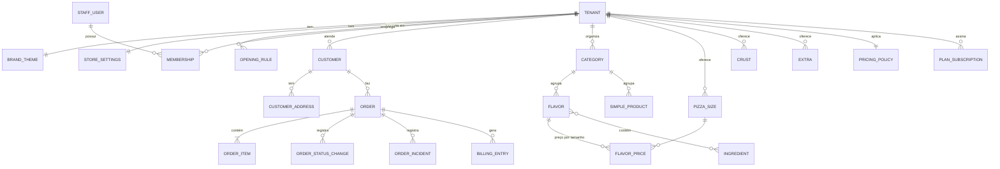
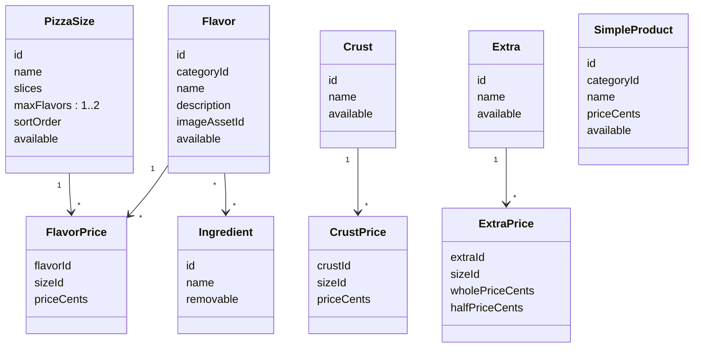

# Modelo de domínio — MVP

Status: especificação M0.3, sem implementação. Define entidades, relacionamentos, invariantes e limites de agregados que a API deve respeitar. Nomes em inglês são os nomes previstos no código; descrições em português.

Convenções gerais:

- Toda entidade pertencente a uma pizzaria tem `tenantId` não nulo e é protegida por RLS ([tenant-isolation](tenant-isolation.md)). Entidades globais estão marcadas como **global**.
- Identificadores UUID; dinheiro em centavos (`integer`, BRL); datas `timestamptz` em UTC.
- “Excluir” itens de catálogo significa arquivar (`archivedAt`), porque pedidos antigos referenciam os identificadores.
- Referências entre agregados são feitas por identificador, nunca por objeto carregado em memória.

## Visão geral

## Agregados

| Agregado               | Raiz               | Contém                                                                                                             | Por que é um limite                                                     |
| ---------------------- | ------------------ | ------------------------------------------------------------------------------------------------------------------ | ----------------------------------------------------------------------- |
| Tenant                 | `Tenant`           | `StoreSettings`, `BrandTheme`, `OpeningRule`, `ClosureException`                                                   | Configuração da pizzaria muda junto e é lida junto pelo app.            |
| Identidade de equipe   | `StaffUser`        | `Membership`, `StaffSession`                                                                                       | Login e vínculos; **global**, com vínculos por tenant.                  |
| Cliente                | `Customer`         | `CustomerAddress`, `CustomerSession`                                                                               | Dados pessoais e exclusão/anonimização em conjunto.                     |
| Catálogo               | um por entidade    | `Category`, `PizzaSize`, `Flavor` (+ `FlavorPrice`, ingredientes), `Crust`, `Extra`, `SimpleProduct`, `Ingredient` | Edição independente; consistência verificada na publicação e no pedido. |
| Política de preço      | `PricingPolicy`    | estratégia meio a meio, sobretaxa, limites                                                                         | Uma por tenant; muda raramente; auditada.                               |
| Pedido                 | `Order`            | `OrderItem`, `OrderStatusChange`, `OrderIncident`                                                                  | Consistência transacional de valores, estado e histórico.               |
| Assinatura             | `PlanSubscription` | —                                                                                                                  | Histórico de plano por tenant.                                          |
| Lançamento de cobrança | `BillingEntry`     | —                                                                                                                  | Append-only; gerado pelo pedido na mesma transação.                     |
| Auditoria              | `AuditEvent`       | —                                                                                                                  | Append-only, transversal.                                               |

## Tenant e configuração

### Tenant

| Campo         | Tipo                                          | Regras                                                                    |
| ------------- | --------------------------------------------- | ------------------------------------------------------------------------- |
| `id`          | UUID                                          |                                                                           |
| `slug`        | texto                                         | Único global, `^[a-z0-9-]{3,40}$`, imutável após o primeiro build do app. |
| `legalName`   | texto                                         | Razão social.                                                             |
| `displayName` | texto                                         | Nome exibido no app.                                                      |
| `document`    | texto                                         | CNPJ ou CPF do responsável (questão aberta para MEI).                     |
| `status`      | `ONBOARDING`, `ACTIVE`, `SUSPENDED`, `CLOSED` | Só `ACTIVE` aceita pedidos.                                               |
| `timezone`    | texto IANA                                    | Padrão `America/Sao_Paulo`.                                               |

Invariantes:

- Um tenant `SUSPENDED` não aceita pedidos nem login de equipe (exceto OWNER, apenas leitura), mas mantém os dados e o cardápio público responde “indisponível”.
- `CLOSED` é terminal; dados seguem a política de retenção.
- Um tenant só passa a `ACTIVE` com: tema válido, ao menos um tamanho, um sabor com preço, `PricingPolicy`, horários e plano vigente.

### StoreSettings

`fulfillmentModes` (subconjunto não vazio de `DELIVERY`, `PICKUP`), `deliveryFeeCents` (≥ 0), `minimumOrderCents` (≥ 0, aplicado ao subtotal de itens), `deliveryAreaDescription` (texto livre, sem cálculo), `estimatedPrepMinutes`, `estimatedDeliveryMinutes`, `acceptTimeoutMinutes` (Q-07), `acceptedPaymentMethods` (subconjunto não vazio de `CASH`, `CARD_ON_DELIVERY`, `PIX_ON_DELIVERY`), `pausedUntil` (pausa manual), `contactPhone`, `pickupAddress`, `privacyPolicyVersion`.

### OpeningRule e ClosureException

- `OpeningRule`: `weekday` (0–6), `opensAt`, `closesAt` (hora local). `closesAt` menor que `opensAt` significa que fecha no dia seguinte (ex.: 18:00–01:00). Regras do mesmo dia não podem se sobrepor.
- `ClosureException`: data local com `closed=true` ou horário substituto.
- A loja está aberta quando: tenant `ACTIVE`, `pausedUntil` nulo ou no passado, nenhuma exceção fechando a data, e o instante atual (no fuso do tenant) está dentro de alguma regra.

### BrandTheme

`logoAssetId`, `iconAssetId`, `splashAssetId`, `colorOverrides` (mapa restrito aos tokens de marca), `fontFamily` (lista fechada), `version`. Publicar um tema exige validação de contraste e formatos. O app usa `version` para invalidar cache.

## Identidade e acesso

### StaffUser (global)

`id`, `email` (único global, normalizado em minúsculas), `name`, `passwordHash`, `mfaSecret` (cifrado, opcional), `platformRole` (`NONE`, `OPERATOR`), `status` (`INVITED`, `ACTIVE`, `DISABLED`), `lastLoginAt`.

### Membership

`staffUserId`, `tenantId`, `role` (`OWNER`, `MANAGER`, `STAFF`), `status` (`INVITED`, `ACTIVE`, `REVOKED`).

Invariantes:

- Par (`staffUserId`, `tenantId`) único.
- Todo tenant `ACTIVE` tem ao menos um `OWNER` ativo; o último OWNER não pode ser removido nem rebaixado.
- O tenant ativo do token de equipe precisa ter vínculo `ACTIVE` verificado a cada requisição (cache curto permitido, invalidado na revogação).

### Customer

`id`, `tenantId`, `name`, `email` (único por tenant), `phone` (E.164, opcional, único por tenant se presente), `passwordHash`, `status` (`ACTIVE`, `DELETED`), `privacyPolicyVersion`, `acceptedAt`.

Invariantes:

- O mesmo e-mail pode existir em tenants diferentes como clientes distintos (D-03). Uma pizzaria nunca enxerga clientes de outra.
- Exclusão anonimiza: `name`, `email`, `phone` e endereços são substituídos/removidos; o `id` permanece para manter pedidos.

### CustomerAddress

`customerId`, `label`, `postalCode`, `street`, `number`, `complement`, `district`, `city`, `state`, `reference`. Sem geocodificação. O pedido copia o endereço (snapshot); alterar o endereço não altera pedidos.

## Catálogo

Invariantes:

- Um sabor só é oferecido num tamanho se existir `FlavorPrice` para o par. Ausência de preço significa indisponível naquele tamanho, nunca preço zero.
- `priceCents` > 0 para sabores; ≥ 0 para bordas, adicionais e produtos (borda “tradicional” gratuita é permitida).
- `halfPriceCents ≤ wholePriceCents ≤ 2 × halfPriceCents`. O painel sugere `ceil(whole / 2)` ao cadastrar, mas o valor gravado é o que vale.
- `maxFlavors` é 1 ou 2 no MVP (3+ fora do escopo).
- Disponibilidade é um booleano simples. Itens arquivados não aparecem no cardápio público e não podem ser pedidos.
- `Category.kind` é `PIZZA` ou `PRODUCT`; sabores só em categorias `PIZZA`, produtos simples só em `PRODUCT`.

Produtos simples não têm variações nem grupos de opções no MVP (ex.: “Refrigerante 2L” e “Refrigerante lata” são produtos distintos).

### PricingPolicy

`halfAndHalfStrategy` (`HIGHEST`, `AVERAGE`), `halfAndHalfSurchargeCents` (≥ 0), `maxExtrasPerHalf`. Uma por tenant. Regras completas em [pizza-builder-rules](../product/pizza-builder-rules.md).

### Publicação do cardápio

O cardápio público é derivado das tabelas de catálogo no momento da leitura, com cache por tenant invalidado em qualquer alteração. Não existe rascunho/publicação separados no MVP: mudanças valem imediatamente. Alternativa (versões de cardápio publicadas) fica para quando houver pedido de agendamento de mudanças.

## Pedido

### Order

| Campo                                                 | Regras                                                                       |
| ----------------------------------------------------- | ---------------------------------------------------------------------------- |
| `number`                                              | Sequencial por tenant (`tenant_order_counters`), exibido como `#123`.        |
| `customerId`                                          | Obrigatório (ou nulo se pedido sem conta for aprovado, Q-05).                |
| `customerSnapshot`                                    | Nome e telefone no momento do pedido.                                        |
| `fulfillment`                                         | `DELIVERY` ou `PICKUP`.                                                      |
| `deliveryAddress`                                     | Snapshot obrigatório se `DELIVERY`; nulo se `PICKUP`.                        |
| `paymentMethod`                                       | Um dos `acceptedPaymentMethods` do tenant no momento do pedido.              |
| `changeForCents`                                      | Só para `CASH`; ≥ total quando informado.                                    |
| `itemsSubtotalCents`                                  | Soma de `OrderItem.totalCents`.                                              |
| `deliveryFeeCents`                                    | Copiado de `StoreSettings` (0 em retirada).                                  |
| `discountCents`                                       | Sempre 0 no MVP (sem cupons); campo existe para não mudar o contrato depois. |
| `totalCents`                                          | `itemsSubtotalCents + deliveryFeeCents − discountCents`.                     |
| `status`                                              | Ver [order-lifecycle](../product/order-lifecycle.md).                        |
| `notes`                                               | Observação do cliente, até 280 caracteres.                                   |
| `idempotencyKeyHash`                                  | Único por (`tenantId`, `customerId`, chave).                                 |
| `placedAt`, `acceptedAt`, `completedAt`, `canceledAt` | Carimbos derivados das transições.                                           |

### OrderItem

`kind` (`PIZZA`, `PRODUCT`), `quantity` (1–20), `unitPriceCents`, `totalCents`, `snapshot` (JSONB). Para pizza, o snapshot contém tamanho, sabores por metade, borda, adicionais e remoções com **nomes e preços usados**, a estratégia aplicada e o detalhamento do cálculo; para produto, nome e preço. Os IDs de catálogo também são guardados para relatórios.

Invariantes do agregado Pedido:

- Valores são calculados pela API com o motor de preço e o catálogo vigente no momento da criação; o preço enviado pelo app é ignorado (só usado para avisar divergência).
- Itens, valores, endereço e forma de pagamento são imutáveis após `PLACED`. Alteração exige cancelar e refazer (edição de pedido fora do MVP).
- `status` só muda por transições permitidas; cada mudança gera `OrderStatusChange` (append-only) e `AuditEvent` quando feita pela equipe.
- `itemsSubtotalCents ≥ minimumOrderCents` na criação.
- Um pedido só é criado se a loja estiver aberta, o modo de entrega estiver habilitado e todos os itens estiverem disponíveis.

### OrderStatusChange

`orderId`, `from`, `to`, `actorType` (`CUSTOMER`, `STAFF`, `SYSTEM`), `actorId`, `reasonCode`, `reasonText`, `at`.

### OrderIncident

`orderId`, `type` (`MISSING_ITEM`, `WRONG_ITEM`, `LATE_DELIVERY`, `QUALITY`, `DELIVERY_PROBLEM`, `OTHER`), `description`, `reportedBy` (`CUSTOMER` via contato com a loja ou `STAFF`), `status` (`OPEN`, `RESOLVED`), `resolutionNote`, datas. Registro de atendimento; não altera valores do pedido nem dispara reembolso no MVP.

## Planos e cobrança

### PlanSubscription

`tenantId`, `plan` (`FLEX`, `PRO`), `feeBasisPoints` (Flex: 300), `monthlyFeeCents` (Pro: 19900), `validFrom`, `validTo` (nulo = vigente). Os valores são copiados do catálogo de planos no momento da assinatura para que mudanças comerciais futuras não alterem históricos.

Invariante: períodos de um tenant não se sobrepõem; sempre existe exatamente uma assinatura vigente para tenant `ACTIVE`.

### BillingEntry (append-only)

| Campo                                                  | Descrição                                                                                          |
| ------------------------------------------------------ | -------------------------------------------------------------------------------------------------- |
| `type`                                                 | `ORDER_COMPLETED`, `ORDER_REVERSED`, `SUBSCRIPTION_PERIOD` (Pro), `ADJUSTMENT` (manual, auditado). |
| `orderId`                                              | Para eventos de pedido.                                                                            |
| `plan`, `feeBasisPoints`                               | Snapshot da assinatura vigente em `completedAt`.                                                   |
| `itemsSubtotalCents`, `deliveryFeeCents`, `totalCents` | Componentes separados para permitir decidir a base (Q-02) sem perder dados.                        |
| `paymentMethod`, `paidOnline`                          | Permite cobrar só vendas online se essa for a decisão (Q-01).                                      |
| `occurredAt`, `period` (`YYYY-MM` no fuso do tenant)   |                                                                                                    |

Regras:

- `ORDER_COMPLETED` é gravado na mesma transação em que o pedido vai para `COMPLETED`, para qualquer plano (no Pro serve como métrica de uso).
- `COMPLETED` é terminal. Se a conclusão foi registrada por engano ou a venda foi desfeita, o OWNER solicita e um operador da plataforma registra o estorno, que gera `ORDER_REVERSED` com valores negativos e motivo; nunca se altera ou apaga um lançamento.
- O valor devido **não** é calculado nem armazenado no MVP; o relatório mensal soma componentes e aplica a regra provisória documentada, marcando o resultado como estimativa.

Decisões de produto pendentes: Q-01, Q-02 e Q-10 em [mvp-scope](../product/mvp-scope.md), mais emissão de nota fiscal do WhiteOven, mínimo mensal, teto, período de teste e tratamento de inadimplência.

## Auditoria

`AuditEvent`: `tenantId` (nulo para ações de plataforma), `actorType`, `actorId`, `action` (ex.: `catalog.flavor.price_changed`), `entityType`, `entityId`, `changes` (JSON com campos alterados, sem dados pessoais desnecessários), `ipHash`, `requestId`, `at`.

## Eventos de domínio

Eventos internos, publicados em memória após o commit (sem broker no MVP). Persistência transacional apenas para o que tem efeito financeiro ou de auditoria.

| Evento               | Consumidores no MVP                                    |
| -------------------- | ------------------------------------------------------ |
| `OrderPlaced`        | Quadro do painel (via polling); push futuro.           |
| `OrderStatusChanged` | Push futuro ao cliente; auditoria.                     |
| `OrderCompleted`     | `BillingEntry` (mesma transação).                      |
| `OrderCanceled`      | Auditoria; `BillingEntry` de estorno se já concluído.  |
| `CatalogChanged`     | Invalidação de cache do cardápio público.              |
| `TenantSuspended`    | Revogação de sessões da equipe; cardápio indisponível. |

Se o MVP precisar de efeitos externos confiáveis (e-mail, push), usar tabela outbox na mesma transação, processada por worker no próprio processo da API.
