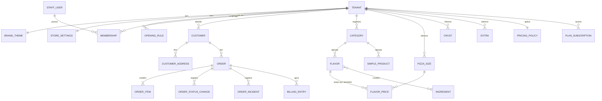
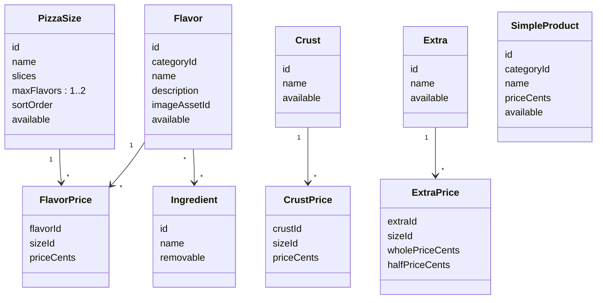

# Modelo de domínio — MVP

Status: especificação M0.3, sem implementação. Define entidades, relacionamentos, invariantes e limites de agregados que a API deve respeitar. Nomes em inglês são os nomes previstos no código; descrições em português.

Convenções gerais:

- Toda entidade pertencente a uma pizzaria tem `tenantId` não nulo e é protegida por RLS ([tenant-isolation](tenant-isolation.md)). Entidades globais estão marcadas como **global**.
- Identificadores UUID; dinheiro em centavos (`integer`, BRL); datas `timestamptz` em UTC.
- “Excluir” itens de catálogo significa arquivar (`archivedAt`), porque pedidos antigos referenciam os identificadores.
- Referências entre agregados são feitas por identificador, nunca por objeto carregado em memória.

## Visão geral

## Agregados

| Agregado               | Raiz               | Contém                                                                                                             | Por que é um limite                                                     |
| ---------------------- | ------------------ | ------------------------------------------------------------------------------------------------------------------ | ----------------------------------------------------------------------- |
| Tenant                 | `Tenant`           | `StoreSettings`, `BrandTheme`, `OpeningRule`, `ClosureException`                                                   | Configuração da pizzaria muda junto e é lida junto pelo app.            |
| Identidade de equipe   | `StaffUser`        | `Membership`, `StaffSession`                                                                                       | Login e vínculos; **global**, com vínculos por tenant.                  |
| Cliente                | `Customer`         | `CustomerAddress`, `CustomerSession`                                                                               | Dados pessoais e exclusão/anonimização em conjunto.                     |
| Catálogo               | um por entidade    | `Category`, `PizzaSize`, `Flavor` (+ `FlavorPrice`, ingredientes), `Crust`, `Extra`, `SimpleProduct`, `Ingredient` | Edição independente; consistência verificada na publicação e no pedido. |
| Política de preço      | `PricingPolicy`    | estratégia meio a meio, sobretaxa, limites                                                                         | Uma por tenant; muda raramente; auditada.                               |
| Pedido                 | `Order`            | `OrderItem`, `OrderStatusChange`, `OrderIncident`                                                                  | Consistência transacional de valores, estado e histórico.               |
| Assinatura             | `PlanSubscription` | —                                                                                                                  | Histórico de plano por tenant.                                          |
| Lançamento de cobrança | `BillingEntry`     | —                                                                                                                  | Append-only; gerado pelo pedido na mesma transação.                     |
| Auditoria              | `AuditEvent`       | —                                                                                                                  | Append-only, transversal.                                               |

## Tenant e configuração

### Tenant

| Campo         | Tipo                                          | Regras                                                                    |
| ------------- | --------------------------------------------- | ------------------------------------------------------------------------- |
| `id`          | UUID                                          |                                                                           |
| `slug`        | texto                                         | Único global, `^[a-z0-9-]{3,40}$`, imutável após o primeiro build do app. |
| `legalName`   | texto                                         | Razão social.                                                             |
| `displayName` | texto                                         | Nome exibido no app.                                                      |
| `document`    | texto                                         | CNPJ ou CPF do responsável (questão aberta para MEI).                     |
| `status`      | `ONBOARDING`, `ACTIVE`, `SUSPENDED`, `CLOSED` | Só `ACTIVE` aceita pedidos.                                               |
| `timezone`    | texto IANA                                    | Padrão `America/Sao_Paulo`.                                               |

Invariantes:

- O que cada status permite está na [matriz de capacidades](#capacidades-por-status-do-tenant). `SUSPENDED` não aceita pedidos novos nem altera configuração; o OWNER só lê e encerra pedidos que já existiam.
- `CLOSED` é terminal; dados seguem a política de retenção.
- Um tenant só passa a `ACTIVE` com: tema válido, ao menos um tamanho, um sabor com preço, `PricingPolicy`, horários e plano vigente.

### Capacidades por status do tenant

Fonte única para os guards da API: `TenantStatusPolicy` é verificada depois do papel e antes do serviço. Toda operação não listada como permitida para o status é negada com `TENANT_NOT_ACTIVE`.

| Operação                                                               | `ONBOARDING`       | `ACTIVE`        | `SUSPENDED`                              | `CLOSED`        |
| ---------------------------------------------------------------------- | ------------------ | --------------- | ---------------------------------------- | --------------- |
| Cardápio, marca e status públicos                                      | Não (indisponível) | Sim             | Não (indisponível)                       | Não             |
| Cliente cria pedido                                                    | Não                | Sim             | Não                                      | Não             |
| Cliente consulta os próprios pedidos e a conta, exclui a conta         | Não se aplica      | Sim             | Sim (somente leitura e exclusão)         | Sim (idem)      |
| Login de MANAGER e STAFF                                               | Sim                | Sim             | Não; sessões revogadas na suspensão      | Não             |
| Login do OWNER                                                         | Sim                | Sim             | Sim, em modo restrito                    | Não             |
| Leitura de catálogo, configurações, pedidos, relatórios                | Sim                | Sim             | Sim (OWNER)                              | Não             |
| Escrita de catálogo, marca, política de preço, horários, pausa, equipe | Sim                | Sim             | Não                                      | Não             |
| Transições de pedido                                                   | Não se aplica      | Todas da tabela | Só encerramento (ver abaixo), pelo OWNER | Não             |
| Registrar ou resolver ocorrência                                       | Não se aplica      | Sim             | Sim (OWNER), só em pedidos existentes    | Não             |
| Ações de plataforma (operador)                                         | Sim                | Sim             | Sim                                      | Somente leitura |

Encerramento de pedidos em tenant `SUSPENDED`:

- Na mesma transação que suspende o tenant, todos os pedidos em `PLACED` vão para `REJECTED` com motivo `STORE_SUSPENDED` e ator `SYSTEM`. Nenhum pedido novo é aceito depois disso, então não existe aceite (`PLACED → PREPARING`) durante a suspensão.
- Pedidos em `PREPARING`, `READY` e `OUT_FOR_DELIVERY` podem seguir apenas as transições que levam a estado terminal: `PREPARING → READY`, `PREPARING → CANCELED`, `READY → OUT_FOR_DELIVERY`, `READY → COMPLETED`, `READY → CANCELED`, `OUT_FOR_DELIVERY → COMPLETED`, `OUT_FOR_DELIVERY → CANCELED`. Só o OWNER as executa.
- A conclusão durante a suspensão gera `BillingEntry` normalmente: a venda aconteceu.
- Reativar (`SUSPENDED → ACTIVE`) não reabre pedidos recusados.

Critério de aceite: teste parametrizado percorre a matriz (status × papel × operação) e confirma permitido/negado em cada célula, incluindo as sete transições de encerramento e a recusa automática de `PLACED` na suspensão.

### StoreSettings

`fulfillmentModes` (subconjunto não vazio de `DELIVERY`, `PICKUP`), `deliveryFeeCents` (≥ 0), `minimumOrderCents` (≥ 0, aplicado ao subtotal de itens), `deliveryAreaDescription` (texto livre, sem cálculo), `estimatedPrepMinutes`, `estimatedDeliveryMinutes`, `acceptTimeoutMinutes` (Q-07), `acceptedPaymentMethods` (subconjunto não vazio de `CASH`, `CARD_ON_DELIVERY`, `PIX_ON_DELIVERY`), `pausedUntil` (pausa manual), `contactPhone`, `pickupAddress`, `privacyPolicyVersion`.

### OpeningRule e ClosureException

- `OpeningRule`: `weekday` (0–6, 0 = domingo), `opensAt`, `closesAt` (hora local, precisão de minuto). `closesAt` menor que `opensAt` significa que fecha no dia seguinte (ex.: 18:00–02:00). `opensAt = closesAt` é inválido (funcionamento 24 horas fora do MVP).
- `ClosureException`: uma **data operacional** local com `closed = true` ou com uma lista de horários substitutos (mesmo formato de `opensAt`/`closesAt`, também podendo cruzar a meia-noite).

**Turno e data operacional.** Cada regra ou horário substituto gera um turno: intervalo semiaberto `[início, fim)` que começa na data operacional D às `opensAt` e termina em D às `closesAt` ou, se cruzar a meia-noite, em D+1 às `closesAt`. O turno pertence sempre à data em que **começa**.

Precedência para montar os turnos de uma data operacional D:

1. Se existe `ClosureException` para D com `closed = true`: D não tem turnos.
2. Senão, se existe `ClosureException` para D com horários substitutos: os turnos de D são exatamente esses horários; as `OpeningRule` do dia da semana de D são ignoradas.
3. Senão: os turnos de D são as `OpeningRule` do dia da semana de D.

Uma exceção nunca afeta turnos de outra data operacional. Assim, um turno de sexta 18:00–02:00 continua valendo até 02:00 de sábado mesmo com o sábado fechado por exceção. Para encerrar mais cedo a madrugada de sábado, cadastra-se exceção na sexta com horário substituto (ex.: 18:00–23:59) ou usa-se a pausa manual.

**Loja aberta no instante t** (convertido para o fuso do tenant): tenant `ACTIVE`, sem pausa vigente (`pausedUntil` nulo ou ≤ t) e t contido em algum turno da data operacional de t ou da data anterior. A pausa manual tem precedência sobre qualquer turno.

Validações ao salvar regras e exceções: turnos não podem se sobrepor considerando a data anterior e a seguinte (ex.: sexta 18:00–02:00 e sábado 01:00–03:00 é inválido), e o mesmo vale para horários substitutos contra os turnos vizinhos efetivos.

Cenários obrigatórios de teste (sexta com regra 18:00–02:00, sábado com regra 18:00–23:00):

| #   | Exceções                        | Instante     | Resultado | Motivo                                     |
| --- | ------------------------------- | ------------ | --------- | ------------------------------------------ |
| H1  | Nenhuma                         | Sexta 23:30  | Aberta    | Turno de sexta                             |
| H2  | Nenhuma                         | Sábado 01:59 | Aberta    | Turno de sexta cruzando a meia-noite       |
| H3  | Nenhuma                         | Sábado 02:00 | Fechada   | Fim do turno é exclusivo                   |
| H4  | Sábado fechado                  | Sábado 01:30 | Aberta    | Exceção de sábado não afeta turno de sexta |
| H5  | Sábado fechado                  | Sábado 19:00 | Fechada   | Sábado sem turnos                          |
| H6  | Sexta fechada                   | Sábado 01:30 | Fechada   | Turno de sexta removido                    |
| H7  | Sábado substituto 12:00–15:00   | Sábado 13:00 | Aberta    | Horário substituto                         |
| H8  | Sábado substituto 12:00–15:00   | Sábado 19:00 | Fechada   | Regra semanal de sábado ignorada           |
| H9  | Sexta substituta 18:00–23:59    | Sábado 00:30 | Fechada   | Substituto de sexta não cruza a meia-noite |
| H10 | Nenhuma, pausa até sábado 00:30 | Sexta 23:45  | Fechada   | Pausa tem precedência                      |

### BrandTheme

`logoAssetId`, `iconAssetId`, `splashAssetId`, `colorOverrides` (mapa restrito aos tokens de marca), `fontFamily` (lista fechada), `version`. Publicar um tema exige validação de contraste e formatos. O app usa `version` para invalidar cache.

## Identidade e acesso

### StaffUser (global)

`id`, `email` (único global, normalizado em minúsculas), `name`, `passwordHash`, `mfaSecret` (TOTP, cifrado com chave fora do banco), `mfaEnabledAt`, `mfaRecoveryCodeHashes`, `platformRole` (`NONE`, `OPERATOR`), `status` (`INVITED`, `ACTIVE`, `DISABLED`), `lastLoginAt`.

Invariante: `platformRole = OPERATOR` só tem efeito com `mfaEnabledAt` preenchido; sem MFA, o usuário não acessa nenhuma rota de plataforma (ver [system-overview](system-overview.md#regras)).

### Membership

`staffUserId`, `tenantId`, `role` (`OWNER`, `MANAGER`, `STAFF`), `status` (`INVITED`, `ACTIVE`, `REVOKED`).

Invariantes:

- Par (`staffUserId`, `tenantId`) único.
- Todo tenant `ACTIVE` tem ao menos um `OWNER` ativo; o último OWNER não pode ser removido nem rebaixado.
- O tenant ativo do token de equipe precisa ter vínculo `ACTIVE` verificado a cada requisição (sem cache; ver ADR 0007).

### Customer

`id`, `tenantId`, `name`, `email` (único por tenant), `phone` (E.164, opcional, único por tenant se presente), `passwordHash`, `status` (`ACTIVE`, `DELETED`), `privacyPolicyVersion`, `acceptedAt`.

Invariantes:

- O mesmo e-mail pode existir em tenants diferentes como clientes distintos (D-03). Uma pizzaria nunca enxerga clientes de outra.
- Exclusão anonimiza: `name`, `email`, `phone` e endereços são substituídos/removidos; o `id` permanece para manter pedidos.

### CustomerAddress

`customerId`, `label`, `postalCode`, `street`, `number`, `complement`, `district`, `city`, `state`, `reference`. Sem geocodificação. O pedido copia o endereço (snapshot); alterar o endereço não altera pedidos.

## Catálogo

Invariantes:

- Um sabor só é oferecido num tamanho se existir `FlavorPrice` para o par. Ausência de preço significa indisponível naquele tamanho, nunca preço zero.
- `priceCents` > 0 para sabores; ≥ 0 para bordas, adicionais e produtos (borda “tradicional” gratuita é permitida).
- `halfPriceCents ≤ wholePriceCents ≤ 2 × halfPriceCents`. O painel sugere `ceil(whole / 2)` ao cadastrar, mas o valor gravado é o que vale.
- `maxFlavors` é 1 ou 2 no MVP (3+ fora do escopo).
- Disponibilidade é um booleano simples. Itens arquivados não aparecem no cardápio público e não podem ser pedidos.
- `Category.kind` é `PIZZA` ou `PRODUCT`; sabores só em categorias `PIZZA`, produtos simples só em `PRODUCT`.

### API de catálogo (M2.3)

O catálogo administrativo de M2.3 grava categorias, tamanhos, ingredientes, sabores, relações sabor–ingrediente e preços de sabor por tamanho em tabelas próprias por tenant. Todas usam RLS forçado e FKs compostas `(tenant_id, id)` para impedir referências cruzadas mesmo sem depender da camada HTTP. Escrita requer membership OWNER ou MANAGER e tenant em `ONBOARDING` ou `ACTIVE`. Categorias, tamanhos, ingredientes e sabores são arquivados por `archived_at`; arquivar um ingrediente preserva seus vínculos com sabores para manter a receita histórica. Vínculos sabor–ingrediente e preços podem ser removidos explicitamente, sempre na mesma transação da auditoria. Uma alteração de preço gera evento com valor anterior e novo; o app não tem acesso direto à tabela global de auditoria, apenas às funções de leitura/gravação com escopo de tenant e membership validado.

### Adicionais e produtos simples (M2.4)

O M2.4 acrescenta bordas (`catalog_crusts`), adicionais (`catalog_extras`), preços de ambos por tamanho, produtos simples em categorias `PRODUCT` e uma `catalog_pricing_policies` por tenant. As novas tabelas usam RLS forçado e FKs compostas por tenant. Um trigger impede associar produto simples a categoria de pizza. Bordas podem ter preço zero; preço de adicional obedece `half_price_cents ≤ whole_price_cents ≤ 2 × half_price_cents`. Cada escrita administrativa gera auditoria por trigger ligado à persistência. OWNER e MANAGER editam o catálogo; STAFF pode somente marcar sabores, bordas, adicionais e produtos como indisponíveis; reativação e `PricingPolicy` ficam com OWNER. Essas ações exigem tenant `ONBOARDING` ou `ACTIVE`.

Produtos simples não têm variações nem grupos de opções no MVP (ex.: “Refrigerante 2L” e “Refrigerante lata” são produtos distintos).

### PricingPolicy

`halfAndHalfStrategy` (`HIGHEST`, `AVERAGE`), `halfAndHalfSurchargeCents` (≥ 0), `maxExtrasPerHalf`. Uma por tenant. Regras completas em [pizza-builder-rules](../product/pizza-builder-rules.md).

### Publicação do cardápio

O cardápio público é derivado das tabelas de catálogo no momento da leitura, com cache por tenant invalidado em qualquer alteração. Não existe rascunho/publicação separados no MVP: mudanças valem imediatamente. Alternativa (versões de cardápio publicadas) fica para quando houver pedido de agendamento de mudanças.

M2.6 implementa `GET /v1/public/stores/{slug}/menu`: só itens pedíveis (não arquivados, disponíveis, em categoria ativa e com preço em tamanho disponível), sem campos internos. Cada escrita no catálogo incrementa `catalog_versions.version` por trigger na mesma transação; a API guarda o cardápio por tenant com essa versão e a compara a cada leitura, então a invalidação vale para todas as instâncias. Loja que não está `ACTIVE` responde `403 TENANT_NOT_ACTIVE`. Detalhes em [ADR 0011](../adr/0011-public-menu-cache.md).

## Pedido

### Order

M1.5 cria a projeção mínima `orders` (`id`, `tenant_id`, `status`, `rejection_reason` e timestamps) para tornar a suspensão transacional. O agregado completo e seus demais campos entram em M4 por migration posterior.

| Campo                                                 | Regras                                                                       |
| ----------------------------------------------------- | ---------------------------------------------------------------------------- |
| `number`                                              | Sequencial por tenant (`tenant_order_counters`), exibido como `#123`.        |
| `customerId`                                          | `NOT NULL` no MVP. Só passa a aceitar nulo se Q-05 aprovar pedido sem conta. |
| `customerSnapshot`                                    | Nome e telefone no momento do pedido.                                        |
| `fulfillment`                                         | `DELIVERY` ou `PICKUP`.                                                      |
| `deliveryAddress`                                     | Snapshot obrigatório se `DELIVERY`; nulo se `PICKUP`.                        |
| `paymentMethod`                                       | Um dos `acceptedPaymentMethods` do tenant no momento do pedido.              |
| `changeForCents`                                      | Só para `CASH`; ≥ total quando informado.                                    |
| `itemsSubtotalCents`                                  | Soma de `OrderItem.totalCents`.                                              |
| `deliveryFeeCents`                                    | Copiado de `StoreSettings` (0 em retirada).                                  |
| `discountCents`                                       | Sempre 0 no MVP (sem cupons); campo existe para não mudar o contrato depois. |
| `totalCents`                                          | `itemsSubtotalCents + deliveryFeeCents − discountCents`.                     |
| `status`                                              | Ver [order-lifecycle](../product/order-lifecycle.md).                        |
| `notes`                                               | Observação do cliente, até 280 caracteres.                                   |
| `placedAt`, `acceptedAt`, `completedAt`, `canceledAt` | Carimbos derivados das transições.                                           |

### OrderCreationKey

Registro da idempotência de criação, separado do pedido para não depender de `customerId`:

| Campo         | Regras                                                                                                                                                                      |
| ------------- | --------------------------------------------------------------------------------------------------------------------------------------------------------------------------- |
| `tenantId`    | Não nulo.                                                                                                                                                                   |
| `scope`       | Texto **não nulo** que identifica quem pode repetir a chave. Hoje: `customer:{customerId}`. Pedido sem conta (se Q-05 aprovar) usará `checkout:{id}` emitido pelo servidor. |
| `keyHash`     | SHA-256 da `Idempotency-Key`.                                                                                                                                               |
| `requestHash` | SHA-256 do corpo normalizado.                                                                                                                                               |
| `orderId`     | Pedido criado.                                                                                                                                                              |
| `expiresAt`   | 24 horas após a criação.                                                                                                                                                    |

Unicidade: `unique (tenant_id, scope, key_hash)`, com todas as colunas `NOT NULL`, de modo que nulos nunca escapem da restrição. Enquanto Q-05 não for decidida, a API rejeita criação de pedido sem cliente autenticado; a decisão de Q-05 define como o `checkout:{id}` é emitido, sem mudar esta tabela.

Critério de aceite: teste de banco confirma que inserir `scope` nulo falha e que duas criações com o mesmo (`tenantId`, `scope`, chave) resultam em um único pedido, inclusive em requisições concorrentes.

### OrderItem

`kind` (`PIZZA`, `PRODUCT`), `quantity` (1–20), `unitPriceCents`, `totalCents`, `snapshot` (JSONB). Para pizza, o snapshot contém tamanho, sabores por metade, borda, adicionais e remoções com **nomes e preços usados**, a estratégia aplicada e o detalhamento do cálculo; para produto, nome e preço. Os IDs de catálogo também são guardados para relatórios.

Invariantes do agregado Pedido:

- Valores são calculados pela API com o motor de preço e o catálogo vigente no momento da criação; o preço enviado pelo app é ignorado (só usado para avisar divergência).
- Itens, valores, endereço e forma de pagamento são imutáveis após `PLACED`. Alteração exige cancelar e refazer (edição de pedido fora do MVP).
- `status` só muda por transições permitidas; cada mudança gera `OrderStatusChange` (append-only) e `AuditEvent` quando feita pela equipe.
- `itemsSubtotalCents ≥ minimumOrderCents` na criação.
- Um pedido só é criado se a loja estiver aberta, o modo de entrega estiver habilitado e todos os itens estiverem disponíveis.

### OrderStatusChange

`orderId`, `from`, `to`, `actorType` (`CUSTOMER`, `STAFF`, `SYSTEM`), `actorId`, `reasonCode`, `reasonText`, `commandKeyHash`, `commandHash`, `at`.

`commandKeyHash` é o SHA-256 da `Idempotency-Key` do comando de transição; `commandHash` é o SHA-256 de (`from`, `to`, `reasonCode`, `reasonText`). Unicidade: `unique (tenant_id, order_id, command_key_hash)`. Semântica completa em [order-lifecycle](../product/order-lifecycle.md#idempotência-e-concorrência-das-transições).

### OrderIncident

`orderId`, `type` (`MISSING_ITEM`, `WRONG_ITEM`, `LATE_DELIVERY`, `QUALITY`, `DELIVERY_PROBLEM`, `OTHER`), `description`, `reportedBy` (`CUSTOMER` via contato com a loja ou `STAFF`), `status` (`OPEN`, `RESOLVED`), `resolutionNote`, datas. Registro de atendimento; não altera valores do pedido nem dispara reembolso no MVP.

## Planos e cobrança

### PlanSubscription

`tenantId`, `plan` (`FLEX`, `PRO`), `feeBasisPoints` (Flex: 300), `monthlyFeeCents` (Pro: 19900), `validFrom`, `validTo` (nulo = vigente). Os valores são copiados do catálogo de planos no momento da assinatura para que mudanças comerciais futuras não alterem históricos.

Invariante: períodos de um tenant não se sobrepõem; sempre existe exatamente uma assinatura vigente para tenant `ACTIVE`.

### BillingEntry (append-only)

| Campo                                                  | Descrição                                                                                          |
| ------------------------------------------------------ | -------------------------------------------------------------------------------------------------- |
| `type`                                                 | `ORDER_COMPLETED`, `ORDER_REVERSED`, `SUBSCRIPTION_PERIOD` (Pro), `ADJUSTMENT` (manual, auditado). |
| `orderId`                                              | Para eventos de pedido.                                                                            |
| `plan`, `feeBasisPoints`                               | Snapshot da assinatura vigente em `completedAt`.                                                   |
| `itemsSubtotalCents`, `deliveryFeeCents`, `totalCents` | Componentes separados para permitir decidir a base (Q-02) sem perder dados.                        |
| `paymentMethod`, `paidOnline`                          | Permite cobrar só vendas online se essa for a decisão (Q-01).                                      |
| `occurredAt`, `period` (`YYYY-MM` no fuso do tenant)   |                                                                                                    |

Regras:

- `ORDER_COMPLETED` é gravado na mesma transação em que o pedido vai para `COMPLETED`, para qualquer plano (no Pro serve como métrica de uso).
- `COMPLETED` é terminal. Se a conclusão foi registrada por engano ou a venda foi desfeita, o OWNER solicita e um operador da plataforma registra o estorno, que gera `ORDER_REVERSED` com valores negativos e motivo; nunca se altera ou apaga um lançamento.
- O valor devido **não** é calculado nem armazenado no MVP; o relatório mensal soma componentes e aplica a regra provisória documentada, marcando o resultado como estimativa.

Decisões de produto pendentes: Q-01, Q-02 e Q-10 em [mvp-scope](../product/mvp-scope.md), mais emissão de nota fiscal do WhiteOven, mínimo mensal, teto, período de teste e tratamento de inadimplência.

## Auditoria

`AuditEvent`: `tenantId` (nulo para ações de plataforma), `actorType`, `actorId`, `action` (ex.: `catalog.flavor.price_changed`), `entityType`, `entityId`, `changes` (JSON com campos alterados, sem dados pessoais desnecessários), `ipHash`, `requestId`, `at`.

## Eventos de domínio

Eventos internos, publicados em memória após o commit (sem broker no MVP). Persistência transacional apenas para o que tem efeito financeiro ou de auditoria.

| Evento               | Consumidores no MVP                                                                                           |
| -------------------- | ------------------------------------------------------------------------------------------------------------- |
| `OrderPlaced`        | Quadro do painel (via polling); push futuro.                                                                  |
| `OrderStatusChanged` | Push futuro ao cliente; auditoria.                                                                            |
| `OrderCompleted`     | `BillingEntry` (mesma transação).                                                                             |
| `OrderCanceled`      | Auditoria; `BillingEntry` de estorno se já concluído.                                                         |
| `CatalogChanged`     | Invalidação de cache do cardápio público.                                                                     |
| `TenantSuspended`    | Recusa de pedidos `PLACED` (mesma transação); revogação de sessões de MANAGER e STAFF; cardápio indisponível. |

Se o MVP precisar de efeitos externos confiáveis (e-mail, push), usar tabela outbox na mesma transação, processada por worker no próprio processo da API.
