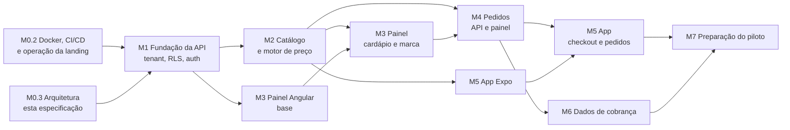

# Roadmap técnico do MVP

Status: especificação M0.3, sem implementação. Cada item abaixo é uma PR pequena e revisável. Nenhuma milestone começa sem aprovação do Product Owner, como já exigido para M1. Referências: [escopo](../product/mvp-scope.md), [arquitetura](system-overview.md), [domínio](domain-model.md), [isolamento](tenant-isolation.md), [Pizza Builder](../product/pizza-builder-rules.md), [pedidos](../product/order-lifecycle.md).

## Princípios para as PRs

- Uma PR entrega uma capacidade testável, com no máximo algumas centenas de linhas de código de produção (testes e migrations à parte). Se crescer, dividir.
- Toda PR mantém `pnpm check`, `pnpm test` e a CI verdes, e atualiza a documentação afetada no mesmo diff.
- Decisões propostas em [system-overview](system-overview.md) (D-01 a D-11) viram ADR na primeira PR que as implementa.
- Toda tabela com `tenant_id` entra na matriz de testes de isolamento na mesma PR ([testes obrigatórios](tenant-isolation.md#testes-obrigatórios)).
- Nenhuma dependência ou fornecedor novo sem justificativa na descrição da PR; fornecedores externos (e-mail, push, build, storage) exigem aprovação explícita.
- Contratos HTTP primeiro em `packages/contracts`, implementação depois.
- Questões de produto bloqueantes estão indicadas; sem resposta, a PR implementa a recomendação documentada de forma configurável ou espera.

## Dependências entre milestones

M2.2 (motor de preço) não depende da API e pode começar logo após M0.3 em paralelo com M1.

## M1 — Fundação da API

Depende de: M0.2 (imagens Docker, Compose e CI) e desta especificação.

| PR   | Entrega                                                                                                                                                                                                                                 | Critérios de aceite                                                                                                                                                                                                                                                                    |
| ---- | --------------------------------------------------------------------------------------------------------------------------------------------------------------------------------------------------------------------------------------- | -------------------------------------------------------------------------------------------------------------------------------------------------------------------------------------------------------------------------------------------------------------------------------------- |
| M1.1 | `apps/api` NestJS mínimo: config validada, `/health`, logs estruturados sem PII, erro padronizado, OpenAPI. ADR da API.                                                                                                                 | Sobe localmente e no Compose de desenvolvimento; CI roda lint, tipos e testes da API; configuração inválida impede o start.                                                                                                                                                            |
| M1.2 | PostgreSQL no Compose de desenvolvimento, MikroORM, migrations, papéis `owner`/`app`/`platform`, testes de integração com banco real.                                                                                                   | Migration cria papéis sem `BYPASSRLS` para a app; testes rodam contra PostgreSQL em container na CI; app não executa DDL.                                                                                                                                                              |
| M1.3 | Tenant, `TenantContext`, guard público por slug, transação com `set_config`, RLS forçado, filtro global, testes de isolamento. ADR D-01.                                                                                                | Os 7 testes obrigatórios de [tenant-isolation](tenant-isolation.md) passam; teste de cobertura de RLS falha se uma tabela nova não tiver política.                                                                                                                                     |
| M1.4 | Equipe: `StaffUser`, `Membership`, login, refresh rotativo, logout, troca de tenant ativo, guards e papéis, bloqueio por tentativas, **MFA TOTP** (cadastro, verificação, códigos de recuperação) e CLI do primeiro operador. ADR D-02. | Senhas com Argon2id; reuso de refresh revoga a sessão; vínculo revogado perde acesso em até 60 s; rotas sem guard falham em teste; operador sem MFA ativo recebe 403 em toda rota de plataforma e só acessa o cadastro do segundo fator. Bloqueado por Q-12 apenas no envio de e-mail. |
| M1.5 | Plataforma: criar tenant, convidar OWNER (link de uso único), suspender/reativar com recusa automática de pedidos `PLACED`, `TenantStatusPolicy`, `AuditEvent` e redefinir MFA de outro operador. ADR 0008.                             | Convite expira em 72 h; teste parametrizado cobre a [matriz de capacidades por status](domain-model.md#capacidades-por-status-do-tenant); todas as ações auditadas; todas as rotas de plataforma exigem MFA de M1.4. Sem e-mail aprovado, o link é exibido ao operador.                |

M1.4 é entregue em duas PRs ([ADR 0007](../adr/0007-staff-authentication.md)): parte A (identidade, vínculos, sessões, troca de tenant, guards, papéis, bloqueio e teste 7 de isolamento) e parte B (MFA TOTP com códigos de recuperação, `PlatformGuard`, primeira rota de plataforma e CLI do primeiro operador).

## M2 — Catálogo e motor de preço

| PR   | Entrega                                                                                                                                                                                                                                                                                                                   | Critérios de aceite                                                                                                                                                                                               |
| ---- | ------------------------------------------------------------------------------------------------------------------------------------------------------------------------------------------------------------------------------------------------------------------------------------------------------------------------- | ----------------------------------------------------------------------------------------------------------------------------------------------------------------------------------------------------------------- |
| M2.1 | Contratos do catálogo e da configuração de pizza em `packages/contracts`.                                                                                                                                                                                                                                                 | Validadores sem dependência de servidor; campos desconhecidos rejeitados; testes de contrato.                                                                                                                     |
| M2.2 | `packages/pizza-pricing`: [pipeline de validação e normalização](../product/pizza-builder-rules.md#pipeline-de-validação-e-normalização) (PB-01 a PB-15) e preço (`HIGHEST`, `AVERAGE`, sobretaxa).                                                                                                                       | Exemplos E1–E8 e casos N1–N11 como testes; testes de propriedade (determinismo, idempotência, equivalência, simetria, normalização não encarece); sem dependências de runtime.                                    |
| M2.3 | **Concluído** — API tenant-scoped de categorias, tamanhos, sabores, ingredientes e preços por tamanho; CRUD/arquivamento, auditoria e auditoria consultável pelo tenant.                                                                                                                                                  | FKs compostas por tenant; RLS forçado; OWNER/MANAGER; preço > 0; escrita negada em tenant suspenso; migration forward-only e matriz de isolamento atualizada.                                                     |
| M2.4 | **Concluído** — API tenant-scoped de bordas, adicionais, produtos simples, `PricingPolicy` e disponibilidade rápida.                                                                                                                                                                                                      | FKs compostas por tenant e RLS forçado; preços de adicional cumprem `half ≤ whole ≤ 2 × half`; STAFF só marca item como indisponível; política só OWNER; matriz de isolamento e contrato administrativo cobertos. |
| M2.5 | **Concluído** — storage substituível com volume local, upload administrativo validado e variantes WebP. ADR 0010 registra a recomendação para Q-13; decisão continua aberta.                                                                                                                                              | Assinatura e formato validados; limite de 5 MiB e 30 MP; UUIDs aleatórios sob prefixo do tenant; acesso autenticado; auditoria; volume persistente e backup documentado.                                          |
| M2.6 | **Concluído na PR #19**, em `codex/m1-5-platform` — `GET /v1/public/stores/{slug}/menu` com nome público da loja e só itens pedíveis; cache em memória por tenant validado pela versão do catálogo e snapshot `REPEATABLE READ` (ADR 0011). Integração na `main` aguarda revisão da PR #20. Tema de marca fica para M3.5. | Só itens disponíveis e não arquivados; tenant suspenso responde indisponível; teste de cache com dois tenants; versão do catálogo somente leitura para o app.                                                     |

## M3 — Painel Angular

| PR   | Entrega                                                                                                                                                             | Critérios de aceite                                                                                                                            |
| ---- | ------------------------------------------------------------------------------------------------------------------------------------------------------------------- | ---------------------------------------------------------------------------------------------------------------------------------------------- |
| M3.1 | **Concluído na PR #21** — `apps/admin` Angular: tokens WhiteOven, login, MFA, refresh por cookie, seleção de tenant, layout acessível e rotas por papel (ADR 0012). | Access token só em memória; navegação por teclado; E2E de login com API de teste.                                                              |
| M3.2 | **Concluído na PR #22** — área de plataforma para listar/cadastrar tenants, criar e resgatar convite OWNER e suspender/reativar lojas.                              | Só `OPERATOR` com MFA acessa operações; confirmação antes de suspender; ações auditadas pela API; convite de uso único expirado após 72 horas. |
| M3.3 | **Concluído na PR #23** — cardápio no painel: categorias, tamanhos, sabores, preços por tamanho, bordas, adicionais, produtos e associação de imagens.              | Prévia de preço usa `pizza-pricing`; validações iguais às da API; esgotar item em um clique.                                                   |
| M3.4 | **Concluído na PR #24** — configurações: política de preço, horários, exceções, pausa, modos, taxa, pedido mínimo, pagamentos (ADR 0013).                           | Prévia dos exemplos de preço com a política escolhida; horários que cruzam meia-noite testados.                                                |
| M3.5 | **Concluído na PR #25** — editor de marca: logotipo, ícone, cores com validação de contraste, prévia do app (ADR 0014).                                             | Tema com contraste insuficiente não é publicado; tokens de acessibilidade não podem ser sobrescritos.                                          |
| M3.6 | **Concluído na PR #26** — equipe: convidar, alterar papel, revogar (ADR 0015).                                                                                      | Último OWNER protegido; revogação encerra sessões.                                                                                             |

## M4 — Pedidos

Bloqueios de produto: Q-04 (taxa, decidida em 2026-10-26: fixa, zero permitido) e Q-07 (tempo de aceite) devem estar respondidos ou seguir a recomendação configurável.

| PR   | Entrega                                                                                                                                                                                                     | Critérios de aceite                                                                                                                                                                                                                                                     |
| ---- | ----------------------------------------------------------------------------------------------------------------------------------------------------------------------------------------------------------- | ----------------------------------------------------------------------------------------------------------------------------------------------------------------------------------------------------------------------------------------------------------------------- |
| M4.1 | **Concluído na PR #27** (ADR 0016) — regras de funcionamento da loja (turnos, exceções por data operacional, pausa) como serviço puro + endpoint público de status.                                         | Cenários H1–H10 de [domain-model](domain-model.md#openingrule-e-closureexception) passam; validação rejeita turnos sobrepostos entre dias vizinhos.                                                                                                                     |
| M4.2 | **Concluído na PR #28** (ADR 0017, Q-05 decidida: e-mail + senha, conta obrigatória) — conta de cliente: cadastro, login, refresh, endereços, exclusão com anonimização.                                    | Cliente escopado por tenant; token de A recusado em B; exclusão remove dados pessoais e preserva pedidos.                                                                                                                                                               |
| M4.3 | **Concluído na PR #29** (ADR 0018, Q-04 decidida: taxa fixa, zero permitido) — `quote` e criação de pedido idempotente (`OrderCreationKey` com escopo não nulo) com snapshot, número sequencial por tenant. | Preço do cliente ignorado; loja fechada recusa; mesma chave e conteúdo retorna o mesmo pedido mesmo após a loja fechar; chave reutilizada com outro conteúdo retorna 409; `scope` nulo é rejeitado pelo banco; criações concorrentes com a mesma chave geram um pedido. |
| M4.4 | **Concluído na PR #30** — máquina de estados, histórico, motivos, cancelamento do cliente, recusa automática por job e idempotência de comandos de transição (Q-07: configurável por loja, padrão 10 min).  | Tabela de transições coberta por teste exaustivo; cenários I1–I8 de [order-lifecycle](../product/order-lifecycle.md#idempotência-e-concorrência-das-transições) passam; job age por tenant com chave determinística.                                                    |
| M4.5 | **Concluído na PR #31** — painel: quadro de pedidos com polling, alerta sonoro, detalhe, transições e comanda em texto.                                                                                     | Pedido novo aparece em até 10 s; duas abas não conseguem aceitar e recusar o mesmo pedido.                                                                                                                                                                              |
| M4.6 | **Concluído na PR #32** (ADR 0019) — histórico, relatório diário e ocorrências (API e painel).                                                                                                              | Filtros paginados; ocorrência não altera valores; relatório soma só `COMPLETED`.                                                                                                                                                                                        |

## M5 — Aplicativo Expo white label

Bloqueios: Q-09 (contas de loja) antes de M5.6; Q-11 (push) para M5.5.

| PR   | Entrega                                                                                                                                                                              | Critérios de aceite                                                                                                           |
| ---- | ------------------------------------------------------------------------------------------------------------------------------------------------------------------------------------ | ----------------------------------------------------------------------------------------------------------------------------- |
| M5.1 | **Concluído na PR #33** (ADR 0020) — `apps/mobile` Expo: `app.config.ts` lendo manifesto do tenant, tema runtime com cache, tela de loja fechada/indisponível.                       | Dois manifestos de exemplo geram apps com nome/ícone diferentes; marca vem da API; abre offline com a última marca.           |
| M5.2 | **Concluído (PR #34; ADR 0021)** — cardápio e Pizza Builder com metades visualmente distintas, adicionais e remoções por metade, acessibilidade; rota pública de imagens e logotipo. | Regras PB-xx aplicadas via `pizza-pricing`; descrição textual de cada metade; movimento reduzido respeitado.                  |
| M5.3 | **Concluído na PR #37** (ADR 0022) — conta do cliente, carrinho persistido com segurança, checkout com `quote`, confirmação e recuperação idempotente.                               | Divergência de preço exige confirmação; retry de rede não duplica pedido; refresh token no armazenamento seguro.              |
| M5.4 | **Em desenvolvimento** (ADR 0023) — acompanhamento, histórico paginado e “pedir novamente” validado no cardápio atual.                                                               | Polling só com o detalhe aberto e app ativo; linha do tempo igual ao histórico da API; novo pedido é cotado no checkout.      |
| M5.5 | Push de mudança de estado (se aprovado).                                                                                                                                             | Opt-in; token do dispositivo por cliente e tenant; nenhum dado pessoal no conteúdo da notificação além do necessário.         |
| M5.6 | Pipeline de build por tenant e checklist de publicação. ADR de build/distribuição (EAS ou próprio).                                                                                  | Build reproduzível a partir do manifesto; documentação do processo nas contas da pizzaria; nenhuma credencial no repositório. |

## M6 — Dados de cobrança

Bloqueios: Q-01, Q-02 e Q-10 precisam de decisão antes de M6.3.

| PR   | Entrega                                                                    | Critérios de aceite                                                                   |
| ---- | -------------------------------------------------------------------------- | ------------------------------------------------------------------------------------- |
| M6.1 | `PlanSubscription` com histórico e troca de plano pelo operador.           | Períodos sem sobreposição; snapshot de valores do plano.                              |
| M6.2 | `BillingEntry` gravado na conclusão do pedido; estorno pelo operador.      | Mesma transação da conclusão; tabela append-only no papel da app; sem dados pessoais. |
| M6.3 | Relatório mensal por tenant (plataforma e OWNER), marcado como estimativa. | Soma por componentes; aplica a regra decidida; reprodutível a partir do ledger.       |

## M7 — Preparação do piloto

| PR   | Entrega                                                                                                                                               | Critérios de aceite                                                                                                                                |
| ---- | ----------------------------------------------------------------------------------------------------------------------------------------------------- | -------------------------------------------------------------------------------------------------------------------------------------------------- |
| M7.1 | Backups e restauração testada de PostgreSQL e imagens; runbook.                                                                                       | Restauração executada e registrada; exclusões reaplicadas antes de restaurar.                                                                      |
| M7.2 | Termos, política de privacidade por pizzaria, contrato de operador de dados (texto fornecido pelo jurídico).                                          | Versão aceita registrada; exclusão de conta disponível no app.                                                                                     |
| M7.3 | Revisão de segurança: matriz de isolamento completa, rate limits, cabeçalhos, revisão (não implementação) do MFA de operadores já exigido desde M1.4. | Checklist assinado; nenhuma rota sem guard; testes de isolamento cobrindo todas as tabelas; confirmação de que nenhum operador ativo está sem MFA. |
| M7.4 | Observabilidade mínima: métricas de pedidos, erros e latência por tenant, alertas de indisponibilidade.                                               | Alertas testados; logs sem PII.                                                                                                                    |
| M7.5 | Onboarding da pizzaria piloto: tenant, cardápio, marca, build e publicação.                                                                           | Pedido real de ponta a ponta concluído; `BillingEntry` conferido.                                                                                  |

## Sequência recomendada

1. Aprovar esta especificação e responder Q-01 a Q-13 que bloqueiam etapas próximas (Q-05, Q-06, Q-12 e Q-13 antes de M1.4/M2).
2. Concluir M0.2 (fora deste escopo).
3. M2.1 e M2.2 em paralelo com M1.1–M1.3, porque o motor de preço é puro e concentra o risco de ambiguidade.
4. M1.4, M1.5, depois M2.3–M2.6.
5. M3.1–M3.6 e M4.1–M4.4 em paralelo, convergindo em M4.5–M4.6.
6. M5.1–M5.4, com M5.6 iniciado cedo para descobrir bloqueios de loja (contas, revisão) antes do piloto.
7. M6 e M7 antes do primeiro pedido real.

## Riscos de execução

- **Agentes de IA em paralelo:** cada PR declara os arquivos que toca; mudanças em `packages/contracts` e migrations são serializadas para evitar conflito.
- **Decisões de produto atrasadas:** implementar a recomendação como configuração, nunca como valor fixo espalhado.
- **Publicação nas lojas:** iniciar M5.6 com a pizzaria piloto antes de M5.4 terminar; revisão da Apple pode levar dias e exigir ajustes.
- **Escopo:** fidelidade, cupons e pagamento online ficam fora até o piloto rodar; reabrir só com decisão registrada.
