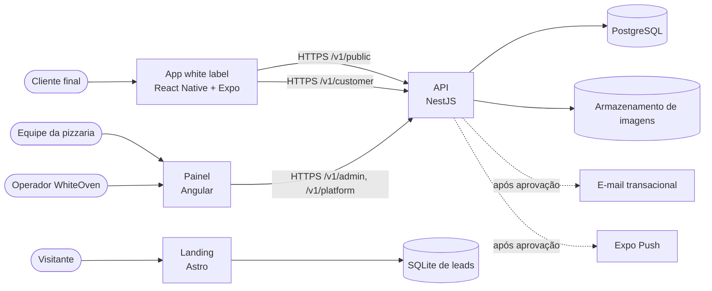
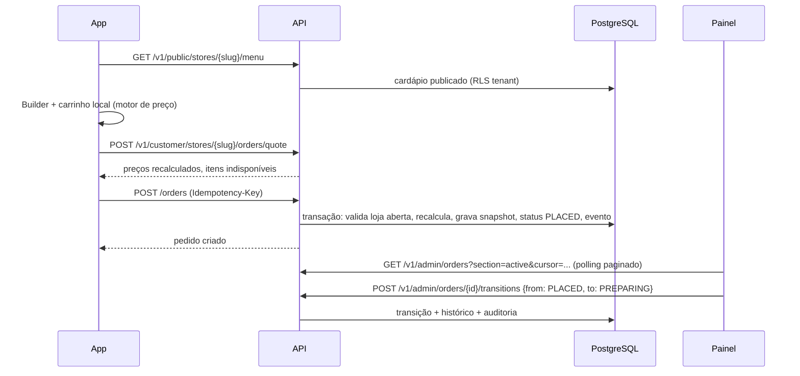

# Arquitetura do sistema — MVP

Status: especificação M0.3, sem implementação. Complementa a [visão de arquitetura](overview.md), que continua descrevendo o estado implementado (M0.1-B). As decisões abaixo devem ser convertidas em ADRs na primeira PR que as implementar, conforme o [roadmap](mvp-roadmap.md).

## Contexto

A landing e sua captação continuam independentes da API ([ADR 0002](../adr/0002-lead-capture.md)). A migração dos leads para a API não faz parte do MVP.

## Componentes e responsabilidades

| Componente       | Local previsto           | Responsabilidade                                                                                           | Não faz                                         |
| ---------------- | ------------------------ | ---------------------------------------------------------------------------------------------------------- | ----------------------------------------------- |
| API              | `apps/api`               | Autoridade de dados, regras de negócio, preço, autenticação, autorização, auditoria e eventos de cobrança. | Renderizar telas; confiar em preços do cliente. |
| Painel           | `apps/admin`             | Operação da pizzaria e da plataforma; editor de cardápio, marca e horários; quadro de pedidos.             | Calcular preço final sem a API.                 |
| Aplicativo       | `apps/mobile`            | Experiência do cliente com a marca da pizzaria; Builder; carrinho local; acompanhamento de pedidos.        | Guardar segredos; acessar outro tenant.         |
| Contratos        | `packages/contracts`     | Tipos e validadores do protocolo HTTP, sem dependências de servidor (padrão já usado nos leads).           | Acessar banco ou rede.                          |
| Motor de preço   | `packages/pizza-pricing` | Função pura de preço e validação de pizza, usada por API, app e painel.                                    | Buscar dados; arredondar fora das regras.       |
| Tokens de design | `packages/design-tokens` | Tokens padrão WhiteOven e esquema dos overrides de marca.                                                  | Conter dados de tenants.                        |
| Landing          | `apps/landing`           | Página comercial e captação de interesse (existente).                                                      | Pedidos ou dados de tenants.                    |
| PostgreSQL       | Docker Compose (VPS)     | Persistência com Row Level Security por tenant.                                                            | —                                               |

Novas aplicações e pacotes só são criados nas milestones que os implementam ([ADR 0001](../adr/0001-monorepo.md)).

## Avaliação da stack planejada

| Escolha             | Avaliação                                                                                                                                                                                                | Decisão |
| ------------------- | -------------------------------------------------------------------------------------------------------------------------------------------------------------------------------------------------------- | ------- |
| NestJS              | Módulos, injeção de dependências, guards e interceptors encaixam com contexto de tenant e autorização por papel. Mantém TypeScript do monorepo e permite compartilhar contratos e motor de preço.        | Mantida |
| MikroORM            | Já citado no escopo. Unit of Work e filtros globais ajudam no escopo por tenant; o isolamento real virá do PostgreSQL (RLS), então o ORM não é a única barreira.                                         | Mantida |
| PostgreSQL          | Row Level Security, transações, `CHECK`/`EXCLUDE`, JSONB para snapshots de pedido e timestamps com fuso. É a peça que viabiliza o isolamento por linha com defesa em profundidade.                       | Mantida |
| Angular             | Adequado a painel com muitos formulários, rotas protegidas e tabelas. Custo: dois frameworks de UI (Angular e React). Mitigado por contratos, motor de preço e tokens compartilhados em TypeScript puro. | Mantida |
| React Native + Expo | Uma base para Android e iOS, configuração dinâmica (`app.config.ts`) para gerar um binário por pizzaria e atualizações OTA para correções de JavaScript.                                                 | Mantida |
| Astro (landing)     | Já implementada; sem relação com o MVP transacional.                                                                                                                                                     | Mantida |

Alternativas consideradas e descartadas:

- **Expo Web para o painel**, unificando o framework de UI: descartado porque o painel é desktop-first, com tabelas e formulários densos, e a preferência de stack definida é Angular.
- **Backend serverless/BaaS (Supabase, Firebase)**: reduziria código de autenticação, mas introduz fornecedor, modelo de cobrança e regras de segurança fora do código revisável; a infraestrutura alvo é VPS com Docker Compose.
- **GraphQL**: o domínio tem poucos clientes e fluxos bem definidos; REST versionado com OpenAPI é mais simples de proteger por rota e de revisar.
- **Prisma em vez de MikroORM**: viável, mas exige extensões para filtros globais e não traz ganho que justifique trocar a escolha registrada.

## Estilo da API

- REST JSON sob `/v1`, documentado por OpenAPI gerado pela própria API.
- Superfícies separadas por audiência, cada uma com seu guard de autenticação:
  - `/v1/public/stores/{storeSlug}/...`: cardápio publicado, horários e marca. Sem autenticação; tenant identificado pelo slug.
  - `/v1/customer/stores/{storeSlug}/...`: conta, endereços, pedidos do cliente. Token de cliente, que já carrega o tenant.
  - `/v1/admin/...`: equipe da pizzaria. Token de equipe + tenant ativo validado por vínculo (membership).
  - `/v1/platform/...`: operadores WhiteOven. Papel de plataforma.
- Dinheiro em centavos inteiros (BRL), como na landing; nunca ponto flutuante.
- Identificadores UUID gerados pela aplicação; timestamps `timestamptz` em UTC; fuso da loja aplicado apenas em regras de horário e exibição.
- `Idempotency-Key` obrigatório na criação de pedidos e convites, no mesmo espírito do formulário de leads.
- Erros com corpo padronizado (`code`, `message`, `details`) sem stack ou SQL.
- Paginação por cursor nas listagens de pedidos.

## Fluxos principais

### Pedido

### Atualização em tempo real

Recomendação para o MVP: polling no painel a cada 10 segundos para pedidos ativos, com alerta sonoro em pedido novo, e polling no app a cada 20 segundos enquanto a tela do pedido estiver aberta. Push ao cliente usa o Expo Push (Q-11 em [mvp-scope](../product/mvp-scope.md); M5.5, [ADR 0027](../adr/0027-order-push-notifications.md)), opt-in e sem substituir o polling. Alternativas: Server-Sent Events (menos latência, mas exige ajustar timeouts do reverse proxy) e WebSocket (bidirecional, desnecessário). SSE pode substituir o polling depois sem mudar o domínio.

## Decisões arquiteturais propostas

| ID   | Decisão                                                                                                                         | Alternativas descartadas                                        | Detalhe                                                  |
| ---- | ------------------------------------------------------------------------------------------------------------------------------- | --------------------------------------------------------------- | -------------------------------------------------------- |
| D-01 | Banco compartilhado, schema compartilhado, coluna `tenant_id` e PostgreSQL RLS como defesa em profundidade.                     | Schema por tenant; banco por tenant; só filtro na aplicação.    | [tenant-isolation](tenant-isolation.md)                  |
| D-02 | Autenticação própria na API (senha com Argon2id, access token curto, refresh token rotativo e revogável), sem provedor externo. | Keycloak; Auth0/Clerk; Firebase Auth; Cognito.                  | [Segurança](#segurança-e-autenticação)                   |
| D-03 | Identidade de equipe global com vínculos por tenant; identidade de cliente separada por tenant.                                 | Conta única de cliente em todas as pizzarias.                   | [domain-model](domain-model.md)                          |
| D-04 | Motor de preço como pacote TypeScript puro compartilhado; API recalcula e é autoridade.                                         | Preço só no servidor (sem prévia offline); preço só no cliente. | [pizza-builder-rules](../product/pizza-builder-rules.md) |
| D-05 | Pedido grava snapshot imutável de nomes e preços; catálogo pode mudar sem alterar pedidos.                                      | Referências vivas ao catálogo.                                  | [domain-model](domain-model.md)                          |
| D-06 | Máquina de estados de pedido explícita no domínio, com histórico append-only.                                                   | Status livre editável.                                          | [order-lifecycle](../product/order-lifecycle.md)         |
| D-07 | Eventos de cobrança gravados na mesma transação da conclusão do pedido (ledger append-only), sem cobrança automática.           | Calcular cobrança só no fim do mês a partir de pedidos.         | [domain-model](domain-model.md)                          |
| D-08 | Tema white label em runtime; identidade de loja (nome, ícone, bundle) por build Expo por tenant.                                | Um app agregador; um binário por pizzaria com tema embutido.    | [White label](#white-label)                              |
| D-09 | REST `/v1` com OpenAPI e superfícies por audiência.                                                                             | GraphQL; tRPC.                                                  | [Estilo da API](#estilo-da-api)                          |
| D-10 | Polling no MVP para pedidos; SSE como evolução.                                                                                 | WebSocket desde o início.                                       | [Tempo real](#atualização-em-tempo-real)                 |
| D-11 | Uma unidade (loja) por tenant no MVP; filiais adiadas.                                                                          | Modelar filiais desde já.                                       | [domain-model](domain-model.md)                          |

## Segurança e autenticação

### Por que autenticação própria

O MVP precisa de dois tipos de login (equipe e cliente), escopo por tenant e revogação. Um provedor de identidade externo resolveria telas e MFA, mas:

- Keycloak exige outro serviço Java com banco, atualização e backup próprios na mesma VPS, custo operacional desproporcional para um piloto.
- Auth0, Clerk e Cognito cobram por usuário ativo e tornam o cliente final de cada pizzaria dependente de um fornecedor; multi-tenant com branding por pizzaria costuma exigir planos pagos.
- Firebase Auth é gratuito em boa parte, mas acopla o projeto ao Google e complica claims de tenant e auditoria.

A autenticação própria é pequena e bem conhecida, desde que siga as regras abaixo. A decisão deve ser revista se surgir requisito de SSO corporativo, MFA obrigatório para clientes ou volume que justifique terceirizar.

### Regras

- Senhas com Argon2id (parâmetros recomendados pela OWASP), mínimo de 10 caracteres, verificação contra lista de senhas vazadas comuns local, sem regras de composição forçadas.
- Access token JWT assinado (EdDSA ou ES256) com validade de 15 minutos e claims mínimos: `sub`, `typ` (`staff` ou `customer`), `tid` (tenant, obrigatório para cliente; tenant ativo para equipe), `sid` (sessão), `mfa` (verdadeiro quando a sessão foi autenticada com segundo fator).
- Refresh token opaco aleatório, armazenado apenas como hash, com rotação a cada uso e detecção de reutilização (reuso revoga a sessão inteira). Validade de 30 dias para cliente e 12 horas deslizantes para equipe.
- Painel: refresh token em cookie `HttpOnly`, `Secure`, `SameSite=Strict`, restrito ao caminho de refresh; access token apenas em memória. CSRF mitigado por SameSite e verificação obrigatória de `Origin` nos endpoints de refresh e logout: cabeçalho ausente ou origem fora de `API_ADMIN_ORIGINS` é recusado.
- Aplicativo: refresh token no armazenamento seguro do sistema (`expo-secure-store`), nunca em AsyncStorage.
- Bloqueio progressivo por conta e por IP após falhas de login; respostas que não revelam se o e-mail existe.
- Recuperação de senha e convite por link de uso único com validade curta (30 minutos e 72 horas), dependentes do provedor de e-mail (Q-12).
- MFA (TOTP, com códigos de recuperação guardados como hash) é **obrigatório para operadores da plataforma desde a primeira versão que expõe rotas de plataforma** (M1.4/M1.5), em qualquer ambiente acessível fora da máquina do desenvolvedor, inclusive homologação. O `PlatformGuard` nega toda rota sem `mfa = true` na sessão. O primeiro operador é criado por comando de linha (CLI) e, no primeiro login, só consegue acessar o cadastro do segundo fator. Redefinir o MFA de um operador exige outro operador e é auditado. O TOTP não depende do provedor de e-mail (Q-12).
- Para OWNER, MANAGER e STAFF o MFA é opcional e recomendado no MVP; torná-lo obrigatório para OWNER é decisão de produto em aberto.

### Autorização

- Status do tenant: depois do papel, a `TenantStatusPolicy` aplica a [matriz de capacidades por status](domain-model.md#capacidades-por-status-do-tenant) (ex.: tenant suspenso só permite leitura e encerramento de pedidos pelo OWNER).
- Guards por superfície: `PublicGuard`, `CustomerGuard`, `StaffGuard`, `PlatformGuard`. Nenhuma rota fica sem guard explícito (teste automatizado lista as rotas e falha se faltar declaração).
- Permissões por papel definidas em código, não em banco, no MVP:

| Ação                                        | OWNER | MANAGER |       STAFF       |
| ------------------------------------------- | :---: | :-----: | :---------------: |
| Operar pedidos (aceitar, avançar, cancelar) |   ✓   |    ✓    |         ✓         |
| Registrar ocorrência                        |   ✓   |    ✓    |         ✓         |
| Esgotar/reativar item                       |   ✓   |    ✓    |         ✓         |
| Editar cardápio e preços                    |   ✓   |    ✓    |                   |
| Editar horários e pausa da loja             |   ✓   |    ✓    | ✓ (somente pausa) |
| Editar marca e configurações de preço       |   ✓   |         |                   |
| Gerenciar equipe                            |   ✓   |         |                   |
| Ver relatórios financeiros e plano          |   ✓   |         |                   |

### Proteção de endpoints

- Validação de entrada por esquema em toda rota, rejeitando campos desconhecidos (padrão já adotado em `packages/contracts`).
- Rate limit por IP e por conta em login, refresh, recuperação de senha e criação de pedido; armazenamento em memória enquanto houver uma instância, revisto antes de escalar horizontalmente (mesmo limite registrado no ADR 0002).
- CORS restrito às origens do painel; o aplicativo nativo não depende de CORS.
- Cabeçalhos de segurança no reverse proxy, limites de corpo e tempo de leitura.
- Upload de imagens: tipos permitidos por assinatura (PNG, JPEG, WebP; SVG só para logotipo após sanitização ou rasterização), tamanho máximo, reprocessamento no servidor, nomes aleatórios e nenhum caminho fornecido pelo cliente.

### Auditoria

`AuditEvent` append-only para ações administrativas: login da equipe, mudanças de cardápio e preço, configuração de marca e preço, equipe, horários, transições de pedido e ações de plataforma. Campos: tenant, ator, papel, ação, entidade, identificador, resumo das mudanças (sem dados pessoais desnecessários), data e hash do IP. Retenção recomendada: 1 ano (questão aberta). Usuário da aplicação no banco não tem `UPDATE`/`DELETE` nessa tabela.

### Dados pessoais (LGPD)

- Papéis: a pizzaria é controladora dos dados dos seus clientes; o WhiteOven atua como operador, o que exige termos de uso e contrato de tratamento de dados com cada pizzaria antes do piloto. O WhiteOven é controlador dos dados da equipe e dos dados de cobrança.
- Dados do cliente no MVP: nome, e-mail, telefone, endereços e pedidos. Sem CPF, data de nascimento ou documento.
- Política de privacidade por pizzaria exibida no aplicativo, com versão aceita registrada no cadastro, seguindo o padrão de versão de consentimento da landing.
- Exclusão de conta pelo próprio cliente no aplicativo (exigência das lojas de aplicativos) com anonimização: pedidos permanecem para fins fiscais e de cobrança, sem nome, telefone, e-mail e endereço identificável.
- Logs sem corpo de requisição, token, senha, telefone ou endereço. Erros reportados com identificadores, não com dados.
- Backups cifrados com retenção definida e reaplicação de exclusões antes de restauração (mesmo princípio do [runbook de leads](lead-deletion-runbook.md)).

## White label

### Personalização por pizzaria

| Elemento                       | Onde é aplicado            | Muda sem nova versão na loja? |
| ------------------------------ | -------------------------- | :---------------------------: |
| Nome exibido, textos e contato | Runtime (configuração)     |              Sim              |
| Logotipo e imagens do cardápio | Runtime (URLs versionadas) |              Sim              |
| Cores (overrides de tokens)    | Runtime                    |              Sim              |
| Cardápio, preços, horários     | Runtime                    |              Sim              |
| Nome do app na loja e na tela  | Build                      |              Não              |
| Ícone e splash                 | Build                      |              Não              |
| Bundle ID / application ID     | Build                      |        Não (imutável)         |
| Conta de desenvolvedor da loja | Publicação                 |              Não              |

O tema segue o esquema já previsto em [design-system](design-system.md): a pizzaria sobrescreve tokens semânticos de marca (primária, hover, pressed, `onPrimary`, destaque), nunca os tokens de acessibilidade e feedback. A API valida contraste (4,5:1 texto normal, 3:1 componentes) antes de publicar. Tipografia: lista curta de fontes empacotadas no app, para evitar download de fontes externas.

### Uma base de código, vários binários

- `apps/mobile` contém um único código. Um manifesto por tenant (`slug`, nome, bundle ID, ícone, splash, cores de fallback) alimenta `app.config.ts` no build.
- O binário só conhece seu `storeSlug`; todo o resto é obtido de `/v1/public/stores/{storeSlug}` e guardado em cache para abrir offline com a última marca conhecida.
- Atualizações de JavaScript (correções e funcionalidades sem código nativo) podem ser distribuídas por OTA (EAS Update ou servidor compatível) a todos os tenants, respeitando as regras das lojas. Mudanças nativas exigem novo build e revisão para cada pizzaria.

### Implicações para distribuição

- **Apple:** as diretrizes de revisão da App Store (4.2.6) rejeitam apps gerados a partir de modelo comercial, a menos que sejam enviados diretamente pelo provedor do conteúdo. Na prática cada pizzaria precisa da própria conta Apple Developer (anuidade em dólar, e conta de organização exige D-U-N-S), com o WhiteOven atuando como membro da equipe para publicar. Há risco de rejeição por funcionalidade mínima (4.2) ou spam (4.3) quando muitos apps parecidos são enviados; cada app deve ter cardápio real e identidade própria.
- **Google Play:** publicar em conta da pizzaria (taxa única de registro) também é o caminho recomendado. Contas pessoais novas têm exigência de teste fechado antes da produção; contas de organização exigem verificação.
- **Custo de build:** iOS exige macOS. Alternativas: EAS Build (serviço Expo, pago conforme volume) ou builds próprios com runner macOS. A decisão entra em ADR no M5.6; até lá nenhum fornecedor é contratado.
- **Escala:** cada nova pizzaria significa um build, duas fichas de loja e revisão. Isso limita a velocidade de onboarding e precisa entrar no preço/operação. Mitigações futuras: cardápio web/PWA como canal imediato enquanto o app passa pela revisão, e automação de builds por manifesto.
- **Alternativa descartada:** um único app WhiteOven com todas as pizzarias (agregador). Evita a revisão por pizzaria, mas contradiz a proposta white label e transforma o WhiteOven em marketplace.

## Infraestrutura e operação

A infraestrutura (Docker, Compose, CI/CD, Caddy, VPS) é responsabilidade da M0.2 e das ADRs que ela produzir. Este documento só registra requisitos que o MVP impõe:

- API e PostgreSQL em containers separados; banco sem porta pública.
- Três papéis no PostgreSQL: `whiteoven_owner` (dono das tabelas, usado só por migrations), `whiteoven_app` (sem `BYPASSRLS`, sem DDL) e `whiteoven_platform` (operações de plataforma entre tenants, auditadas, com políticas próprias). Detalhes em [tenant-isolation](tenant-isolation.md).
- Migrations versionadas executadas antes do start da nova versão, nunca pela aplicação em runtime.
- Backups diários cifrados do PostgreSQL e do armazenamento de imagens, com teste de restauração antes do piloto.
- Logs estruturados com `requestId` e `tenantId`, sem dados pessoais.
- Uma instância de API no MVP; rate limit e cache em memória precisam de revisão antes de escalar.

## Riscos

| Risco                                        | Impacto | Mitigação                                                                                   |
| -------------------------------------------- | ------- | ------------------------------------------------------------------------------------------- |
| Vazamento de dados entre pizzarias           | Crítico | RLS + filtros + testes de isolamento obrigatórios em CI ([detalhes](tenant-isolation.md)).  |
| Rejeição dos apps nas lojas                  | Alto    | Conta da pizzaria, conteúdo real, PWA como plano B, validar com piloto cedo.                |
| Divergência de preço entre app e API         | Alto    | Pacote único de preço, testes de propriedade, API como autoridade, `quote` antes do pedido. |
| Base de cobrança indefinida (Q-01/Q-02)      | Médio   | Ledger com componentes separados; decisão antes de M6.                                      |
| Dois frameworks de UI                        | Médio   | Lógica em pacotes TypeScript puros; telas finas.                                            |
| Operação de autenticação própria             | Médio   | Escopo pequeno, bibliotecas consolidadas, testes de segurança, revisão antes do piloto.     |
| Polling sobrecarregar a API com muitas lojas | Baixo   | Índices em pedidos ativos, ETag/`If-None-Match`, evolução para SSE.                         |
