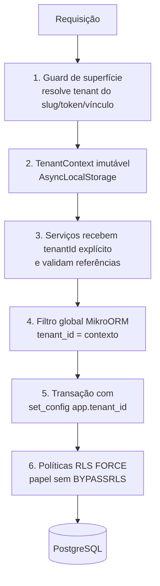

# Isolamento de tenants

Status: especificação M0.3, implementada em M1.3 ([ADR 0006](../adr/0006-tenant-isolation.md)): `tenants`, `TenantContext`, guard por slug, `set_config(..., true)` por transação, RLS forçado, filtro global e testes 1–6. O teste 7 (revogação) depende de `Membership` e entra em M1.4. Define como a API garante que uma pizzaria nunca leia nem altere dados de outra. Esta estratégia é pré-requisito de qualquer fluxo de negócio (M1.3 no [roadmap](mvp-roadmap.md)).

## Decisão

**Banco PostgreSQL compartilhado, schema compartilhado, coluna `tenant_id` em toda tabela de tenant e Row Level Security (RLS) forçado**, com filtros do ORM e verificações na aplicação como camadas adicionais.

| Alternativa                        | Isolamento                       | Operação no MVP                                                                 | Avaliação                                          |
| ---------------------------------- | -------------------------------- | ------------------------------------------------------------------------------- | -------------------------------------------------- |
| Banco por tenant                   | Máximo                           | N bancos, N migrations, N backups, conexões multiplicadas na mesma VPS.         | Descartada: custo incompatível com R$ 199/mês.     |
| Schema por tenant                  | Alto                             | Migrations repetidas por schema; pool por `search_path`; catálogo do PG cresce. | Descartada: complexidade sem ganho real no piloto. |
| `tenant_id` só filtrado no código  | Depende de cada consulta         | Simples.                                                                        | Descartada: uma consulta esquecida vaza dados.     |
| **`tenant_id` + RLS + filtro ORM** | Alto, com defesa em profundidade | Um banco, uma migration, um backup.                                             | **Escolhida.**                                     |

Revisão: se um cliente exigir isolamento físico (contrato, volume), a coluna `tenant_id` permite extrair os dados para banco dedicado sem remodelar.

## Camadas de defesa



Cada camada assume que a anterior pode falhar. A camada 6 é a que impede vazamento mesmo com bug na aplicação.

## Identificação do tenant

| Superfície                        | Origem do tenant                                                                           | Validação                                                                                     |
| --------------------------------- | ------------------------------------------------------------------------------------------ | --------------------------------------------------------------------------------------------- |
| `/v1/public/stores/{storeSlug}`   | Slug na URL, embutido no build do app.                                                     | Slug existe; tenant `ACTIVE` (ou resposta “indisponível” sem detalhes).                       |
| `/v1/customer/stores/{storeSlug}` | Claim `tid` do token de cliente.                                                           | `tid` deve corresponder ao slug da URL; divergência retorna 404, não 403.                     |
| `/v1/admin`                       | Claim `tid` (tenant ativo) do token de equipe.                                             | Vínculo `ACTIVE` para (`sub`, `tid`) e tenant não `CLOSED`. Troca de tenant emite novo token. |
| `/v1/platform`                    | Nenhum por padrão; operador informa tenant explicitamente quando a ação é sobre um tenant. | `platformRole = OPERATOR`; toda ação auditada.                                                |

Regras:

- O tenant **nunca** vem de cabeçalho livre (`X-Tenant-Id`), de corpo de requisição ou de query string controlada pelo cliente.
- Identificadores de recursos de outro tenant retornam 404, para não confirmar existência.
- Não existe subdomínio por tenant no MVP; se for adotado depois, o subdomínio só seleciona o tenant e continua validado contra o token.

## Banco de dados

### Esquema

- Toda tabela de tenant tem `tenant_id uuid not null references tenants(id)`.
- Chaves estrangeiras entre tabelas de tenant são compostas: `foreign key (tenant_id, flavor_id) references flavors (tenant_id, id)`. Assim o banco impede que um pedido do tenant A referencie um sabor do tenant B, mesmo com RLS desativado em uma migration. Cada tabela referenciada tem `unique (tenant_id, id)`.
- Unicidades de negócio incluem o tenant: `unique (tenant_id, email)` em clientes, `unique (tenant_id, number)` em pedidos.
- Índices de consulta começam por `tenant_id`.

Tabelas globais (sem `tenant_id`): `tenants`, `staff_users`, `staff_sessions`, `plans`. `memberships` tem `tenant_id` e RLS, mas o login precisa listar vínculos do usuário; essa consulta usa função `security definer` restrita ao `sub` autenticado.

### Políticas

```sql
-- Gerado por tenantIsolationSql('flavors') (apps/api/src/database/tenant-isolation-sql.ts).
alter table flavors enable row level security;
alter table flavors force row level security;

create policy tenant_isolation on flavors
  using (tenant_id = whiteoven_current_tenant())
  with check (tenant_id = whiteoven_current_tenant());

-- Migration20261024010000_tenants:
-- whiteoven_current_tenant() = nullif(current_setting('app.tenant_id', true), '')::uuid
```

- `current_setting(..., true)` retorna nulo sem contexto (ou `''` numa conexão que já usou a variável, convertido em nulo pelo `nullif`), e a comparação com nulo nega tudo: ausência de contexto falha fechada.
- `FORCE ROW LEVEL SECURITY` aplica a política inclusive ao dono da tabela.
- A aplicação conecta como `whiteoven_app`, sem `BYPASSRLS`, sem superusuário, sem DDL. Migrations usam `whiteoven_owner`, nunca disponível ao processo da API em runtime.

### Contexto por transação

- Toda requisição com tenant abre transação e executa `select set_config('app.tenant_id', $1, true)` (equivalente a `SET LOCAL`). O valor some ao fim da transação, então conexões devolvidas ao pool não carregam tenant anterior.
- Proibido `SET` de sessão (sem `LOCAL`) para o tenant.
- Consultas fora de transação com tenant são bloqueadas por um wrapper do `EntityManager`; o lint/review rejeita acesso direto ao driver.
- Operações de plataforma que atravessam tenants (ex.: relatório de cobrança) usam papel e conexão separados (`whiteoven_platform`, com políticas próprias que exigem `app.platform_operation` definido) e são auditadas. Não usar `BYPASSRLS` na aplicação.

### Jobs e processos sem requisição

Recusa automática por tempo, limpeza e relatórios iteram tenants explicitamente: para cada tenant, abrem transação com seu contexto. Nenhum job roda consulta “de todos os tenants” no papel da aplicação.

## Aplicação

- `TenantContext` (tenantId, tipo de ator, ator, papel) criado pelo guard e guardado em `AsyncLocalStorage`; imutável durante a requisição.
- Filtro global do MikroORM habilitado por padrão em toda entidade de tenant, com parâmetro do contexto; desabilitar exige anotação explícita revisada.
- Ao receber IDs no corpo (sabores de um item, endereço do pedido), o serviço carrega as entidades **dentro do contexto** e falha se alguma não for encontrada; nunca confia que o ID pertence ao tenant.
- Respostas são montadas por DTOs explícitos; nada de serializar entidades inteiras.
- Cache em memória (cardápio público, vínculos) sempre com `tenantId` na chave.
- Logs e métricas incluem `tenantId`; arquivos e imagens ficam sob prefixo do tenant (`tenants/{tenantId}/...`) com nomes aleatórios.

## Ameaças e mitigações

| #    | Ameaça                                                     | Mitigação                                                                                                                               |
| ---- | ---------------------------------------------------------- | --------------------------------------------------------------------------------------------------------------------------------------- |
| T-01 | Consulta sem filtro de tenant (bug)                        | RLS forçado; filtro global do ORM; teste de isolamento por tabela.                                                                      |
| T-02 | IDOR: ID de recurso de outro tenant na URL ou corpo        | Carga dentro do contexto; FK compostas; 404 uniforme.                                                                                   |
| T-03 | Token de cliente do tenant A usado na URL do tenant B      | `tid` precisa bater com o slug; teste dedicado.                                                                                         |
| T-04 | Membro removido continua com token válido                  | Verificação de vínculo a cada requisição (cache curto invalidado na revogação); refresh revogado.                                       |
| T-05 | Conexão do pool reaproveitada com tenant anterior          | `set_config(..., true)` só dentro de transação; teste que reutiliza conexão.                                                            |
| T-06 | Cache compartilhado servindo cardápio de outra pizzaria    | `tenantId` na chave; teste com dois tenants.                                                                                            |
| T-07 | Arquivo/imagem acessível por URL adivinhável               | Nomes aleatórios, prefixo por tenant; imagens de cardápio são públicas por natureza, documentos privados não são servidos diretamente.  |
| T-08 | Operador da plataforma acessando dados sem necessidade     | Endpoints de plataforma mínimos, auditoria, sem impersonação no MVP.                                                                    |
| T-09 | Migration ou script operacional que desativa RLS           | Papel separado; checklist de review; teste de CI verifica `relrowsecurity` e `relforcerowsecurity` em todas as tabelas com `tenant_id`. |
| T-10 | Enumeração de slugs/tenants                                | Slugs são públicos por design (estão no app); respostas não expõem dados além do cardápio.                                              |
| T-11 | Relatório de cobrança agregando dados pessoais de clientes | Ledger sem dados pessoais; relatórios usam apenas valores e IDs.                                                                        |
| T-12 | Vazamento por logs/erros                                   | Logs sem corpo e sem PII; erros sem SQL ou stack.                                                                                       |

## Testes obrigatórios

Executados em CI contra PostgreSQL real (container), não contra mocks:

1. **Matriz de isolamento:** fixture com tenants A e B; para cada rota autenticada, usuário de A tenta ler/alterar recurso de B e recebe 404 sem efeito colateral.
2. **Cobertura de RLS:** consulta ao catálogo do PostgreSQL falha se alguma tabela com coluna `tenant_id` não tiver RLS habilitado e forçado.
3. **Falha fechada:** consulta no papel da aplicação sem `app.tenant_id` retorna zero linhas e inserção falha.
4. **Pool:** duas requisições sequenciais de tenants diferentes na mesma conexão não compartilham contexto.
5. **FK compostas:** inserir item de pedido do tenant A com sabor do tenant B falha no banco.
6. **Token cruzado:** token de cliente de A em rota de B falha.
7. **Revogação:** membro revogado perde acesso em até o TTL do cache de vínculo (máximo 60 segundos).

Nenhuma PR que adicione tabela de tenant é aceita sem incluir a tabela nos testes 1 e 2.
