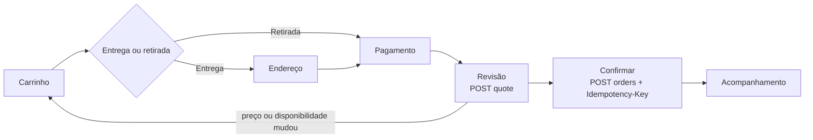
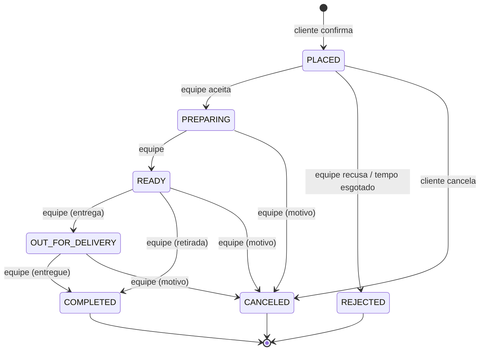

# Ciclo de vida do pedido

Status: especificação M0.3, sem implementação. Define carrinho, checkout, estados, transições, cancelamento, histórico, ocorrências e regras de funcionamento da loja. Entidades em [domain-model](../architecture/domain-model.md); preços em [pizza-builder-rules](pizza-builder-rules.md).

## Carrinho

- Local no dispositivo, separado por pizzaria (`storeSlug`). Não há carrinho no servidor no MVP: evita estado abandonado no banco e funciona com o app recém-aberto.
- O app calcula preços com o pacote de preço para exibição; a API recalcula em `quote` e na criação.
- O carrinho guarda IDs e configurações, não preços. Ao abrir o app, itens arquivados ou indisponíveis são marcados e não podem seguir para o checkout.
- Limites: até 30 linhas e quantidade de 1 a 20 por linha.

Alternativa descartada: carrinho persistido na API. Útil para recuperar carrinho entre dispositivos ou campanhas de abandono, que não estão no MVP.

## Checkout

Validações na criação (todas no servidor, na mesma transação):

1. Cliente autenticado no tenant do `storeSlug` (Q-05 decidida: conta obrigatória, [ADR 0017](../adr/0017-customer-identity.md)).
2. Tenant `ACTIVE` e loja aberta (regras abaixo).
3. Modo (`DELIVERY`/`PICKUP`) habilitado em `StoreSettings`.
4. Entrega: endereço completo (CEP, rua, número, bairro, cidade, UF). Sem validação de área por distância; o texto da área atendida é exibido antes da confirmação e a pizzaria pode recusar com `OUT_OF_DELIVERY_AREA`.
5. Todos os itens válidos e disponíveis; preços recalculados.
6. `itemsSubtotalCents ≥ minimumOrderCents`.
7. Forma de pagamento aceita pela loja; troco (`changeForCents`) só em dinheiro e maior ou igual ao total.
8. `Idempotency-Key` UUID, registrada em `OrderCreationKey` com escopo não nulo (`customer:{customerId}` no MVP): repetição com o mesmo conteúdo retorna o mesmo pedido; mesma chave com conteúdo diferente retorna 409 (mesma semântica do formulário de leads). Chave válida por 24 horas. A verificação da chave acontece antes das validações 2 a 7, para que um retry de um pedido já criado não falhe porque a loja fechou entre as tentativas. Detalhes em [domain-model](../architecture/domain-model.md#ordercreationkey).

Totais: `total = subtotal de itens + taxa de entrega − desconto` (desconto sempre 0 no MVP). A taxa de entrega é fixa por pizzaria e zero em retirada (Q-04).

Pagamento no MVP é sempre offline (dinheiro, cartão na entrega/retirada, Pix presencial) e apenas registrado. Não há status de pagamento, captura ou estorno; isso entra com o pagamento online (Q-03).

## Funcionamento da loja

A loja aceita pedidos quando **todas** as condições valem no instante da criação, no fuso do tenant:

1. Tenant `ACTIVE`.
2. Sem pausa manual vigente (`pausedUntil` nulo ou no passado). A equipe pausa por 15, 30 ou 60 minutos, ou até reabrir manualmente. A pausa tem precedência sobre qualquer horário.
3. O instante está dentro de um turno da data operacional atual ou da anterior (turno que cruza a meia-noite pertence à data em que começa). `ClosureException` remove ou substitui apenas os turnos da própria data operacional.
4. `closesAt` é exclusivo e é o limite para **criar** pedidos; pedidos já criados continuam sendo processados após o fechamento.

A definição formal de turno, a precedência entre `OpeningRule` e `ClosureException` e os cenários de teste H1 a H10 estão em [domain-model](../architecture/domain-model.md#openingrule-e-closureexception); este documento não repete as regras para não divergir.

O cardápio continua visível com a loja fechada, com aviso e próximo horário de abertura. Pedidos agendados não existem no MVP. Antecedência de corte (ex.: parar de aceitar 15 minutos antes de fechar) é questão aberta (OL-Q2).

## Estados

| Estado             | Rótulo para o cliente                     | Significado                                               |
| ------------------ | ----------------------------------------- | --------------------------------------------------------- |
| `PLACED`           | Aguardando confirmação                    | Pedido criado; a pizzaria ainda não aceitou.              |
| `PREPARING`        | Em preparo                                | Aceito pela pizzaria.                                     |
| `READY`            | Pronto (retirada: “Pronto para retirada”) | Preparado, aguardando saída ou retirada.                  |
| `OUT_FOR_DELIVERY` | Saiu para entrega                         | Marcado manualmente; sem rastreamento.                    |
| `COMPLETED`        | Entregue / Retirado                       | Terminal. Gera evento faturável.                          |
| `REJECTED`         | Recusado pela loja                        | Terminal. Não aceito (pela equipe ou por tempo esgotado). |
| `CANCELED`         | Cancelado                                 | Terminal. Cancelado depois de criado.                     |

Alternativa descartada: estado `ACCEPTED` separado de `PREPARING`. Em pizzarias pequenas aceitar significa começar o preparo; um estado extra só aumenta cliques. Se surgir fila de produção, o estado pode ser adicionado sem quebrar os demais.

## Transições

| De                 | Para               | Quem    | Condição                               | Motivo obrigatório |
| ------------------ | ------------------ | ------- | -------------------------------------- | :----------------: |
| `PLACED`           | `PREPARING`        | STAFF+  | —                                      |                    |
| `PLACED`           | `REJECTED`         | STAFF+  | —                                      |         ✓          |
| `PLACED`           | `REJECTED`         | SYSTEM  | `acceptTimeoutMinutes` esgotado (Q-07) |  `ACCEPT_TIMEOUT`  |
| `PLACED`           | `REJECTED`         | SYSTEM  | Tenant suspenso (mesma transação)      | `STORE_SUSPENDED`  |
| `PLACED`           | `CANCELED`         | Cliente | Ainda não aceito                       | `CUSTOMER_REQUEST` |
| `PREPARING`        | `READY`            | STAFF+  | —                                      |                    |
| `PREPARING`        | `CANCELED`         | STAFF+  | —                                      |         ✓          |
| `READY`            | `OUT_FOR_DELIVERY` | STAFF+  | `fulfillment = DELIVERY`               |                    |
| `READY`            | `COMPLETED`        | STAFF+  | `fulfillment = PICKUP`                 |                    |
| `READY`            | `CANCELED`         | STAFF+  | —                                      |         ✓          |
| `OUT_FOR_DELIVERY` | `COMPLETED`        | STAFF+  | —                                      |                    |
| `OUT_FOR_DELIVERY` | `CANCELED`         | STAFF+  | —                                      |         ✓          |

STAFF+ significa qualquer papel da pizzaria (STAFF, MANAGER, OWNER). Qualquer transição fora desta tabela é rejeitada com `ORDER_INVALID_TRANSITION`.

Regras gerais:

- Toda transição pedida por cliente ou equipe é um comando com `Idempotency-Key`, `from` e `to` (e motivo, quando obrigatório). Ver [idempotência e concorrência](#idempotência-e-concorrência-das-transições).
- Cada transição grava `OrderStatusChange` e, quando feita pela equipe, `AuditEvent`, na mesma transação.
- A ida para `COMPLETED` grava `BillingEntry` na mesma transação.
- Não há transição saindo de estados terminais. Correção de pedido concluído por engano é feita por estorno de cobrança, sem mudar o estado (ver [domain-model](../architecture/domain-model.md)).
- Recusa automática: job periódico (a cada minuto) por tenant, transição feita pelo ator `SYSTEM`.
- Suspensão do tenant: na mesma transação, pedidos em `PLACED` vão para `REJECTED` com `STORE_SUSPENDED` (ator `SYSTEM`). Pedidos em `PREPARING`, `READY` e `OUT_FOR_DELIVERY` só podem seguir as transições da tabela que levam a estado terminal, executadas pelo OWNER. Matriz completa em [domain-model](../architecture/domain-model.md#capacidades-por-status-do-tenant).

### Idempotência e concorrência das transições

Retry do mesmo comando e conflito entre comandos diferentes são situações distintas e têm respostas distintas. O cliente (app ou painel) gera uma `Idempotency-Key` nova para cada **ação do usuário** (cada clique em “Aceitar”, “Cancelar” etc.) e a reutiliza apenas ao repetir essa mesma ação por timeout ou erro de rede.

Autenticação e papel são verificados pelos guards antes de tudo (403 sem efeito). Depois, a API processa o comando nesta ordem, dentro de uma transação com bloqueio da linha do pedido (`SELECT ... FOR UPDATE`):

1. **Chave já usada neste pedido** (`OrderStatusChange` com o mesmo `commandKeyHash`):
   - mesmo `commandHash` (`from`, `to`, motivo): retorna **200 com o resultado original** (a mudança registrada naquele momento e o estado atual do pedido), sem gravar nada, mesmo que o pedido já tenha avançado depois;
   - `commandHash` diferente: **409 `IDEMPOTENCY_KEY_REUSED`**.
2. **Chave nova e `from` diferente do estado atual**: **409 `ORDER_STATE_CONFLICT`** com o estado atual e a última mudança, para o painel recarregar. É o caso de duas pessoas agindo ao mesmo tempo.
3. **Chave nova e `from` igual ao estado atual, mas transição inválida**: fora da tabela retorna **422 `ORDER_INVALID_TRANSITION`**; prevista na tabela, mas não permitida para o status do tenant, retorna **403 `TENANT_NOT_ACTIVE`**.
4. **Caso contrário**: aplica a transição e grava `OrderStatusChange` com a chave, na mesma transação do histórico, da auditoria e do `BillingEntry`.

Se duas requisições com a mesma chave chegam juntas, o bloqueio da linha e a restrição `unique (tenant_id, order_id, command_key_hash)` garantem que só uma grava; a outra cai no passo 1. A chave vale enquanto o pedido existir.

Transições do ator `SYSTEM` usam chave determinística (`system:accept-timeout`, `system:tenant-suspended`), então um job repetido cai no passo 1 em vez de duplicar histórico.

Cenários obrigatórios (pedido em `PLACED`):

| #   | Sequência                                          | Resposta esperada                                       |
| --- | -------------------------------------------------- | ------------------------------------------------------- |
| I1  | Aceitar (K1, `PLACED → PREPARING`)                 | 200; pedido em `PREPARING`                              |
| I2  | I1 e repetir K1 com o mesmo corpo (timeout)        | 200 com o resultado de I1; um único histórico           |
| I3  | I1, avançar para `READY` (K2) e repetir K1         | 200 com o resultado de I1; pedido continua em `READY`   |
| I4  | I1 e repetir K1 com `to = REJECTED`                | 409 `IDEMPOTENCY_KEY_REUSED`                            |
| I5  | I1 e outra tela envia recusa (K3, `from = PLACED`) | 409 `ORDER_STATE_CONFLICT` com estado `PREPARING`       |
| I6  | K1 e K3 (aceitar e recusar) concorrentes           | Exatamente uma aplicada; a outra recebe 409 de conflito |
| I7  | K1 enviado duas vezes concorrentemente             | Um histórico; as duas respostas iguais                  |
| I8  | Job de recusa automática executado duas vezes      | Um histórico `ACCEPT_TIMEOUT`                           |

### Motivos

| Código                 | Uso                                            |
| ---------------------- | ---------------------------------------------- |
| `CUSTOMER_REQUEST`     | Cliente cancelou no app ou pediu por telefone. |
| `ITEM_UNAVAILABLE`     | Ingrediente ou produto acabou.                 |
| `STORE_TOO_BUSY`       | Pizzaria sem capacidade.                       |
| `OUT_OF_DELIVERY_AREA` | Endereço fora da área atendida.                |
| `CUSTOMER_UNREACHABLE` | Cliente não atendeu ou não estava no endereço. |
| `NOT_PICKED_UP`        | Retirada não realizada.                        |
| `SUSPECTED_FRAUD`      | Pedido suspeito (trote).                       |
| `ACCEPT_TIMEOUT`       | Exclusivo do sistema.                          |
| `STORE_SUSPENDED`      | Exclusivo do sistema, na suspensão do tenant.  |
| `OTHER`                | Exige texto livre de até 280 caracteres.       |

O cliente vê um texto amigável derivado do código, nunca o texto interno de `OTHER`.

## Cancelamento

- **Cliente:** só em `PLACED`, pelo app. Depois do aceite, o app mostra o telefone da pizzaria; a equipe cancela com `CUSTOMER_REQUEST` se concordar.
- **Pizzaria:** recusa em `PLACED` e cancelamento em `PREPARING`, `READY` e `OUT_FOR_DELIVERY`, sempre com motivo.
- **Financeiro:** como o pagamento é offline, cancelar não gera estorno no sistema. Pedidos cancelados ou recusados não geram `BillingEntry`.
- Taxa de cancelamento não existe no MVP.

## Acompanhamento e notificações

- App: tela do pedido com estado atual, linha do tempo (horários de cada transição) e previsão simples (`estimatedPrepMinutes` + `estimatedDeliveryMinutes`, sem cálculo de rota). Atualização por polling a cada 20 segundos enquanto a tela estiver aberta.
- Push ao cliente em cada mudança de estado depende da aprovação do Expo Push (Q-11).
- Painel: quadro com colunas por estado ativo (`PLACED`, `PREPARING`, `READY`, `OUT_FOR_DELIVERY`), polling a cada 10 segundos, alerta sonoro e destaque enquanto houver pedido em `PLACED`, contador de tempo desde a criação.

## Histórico

- Cliente: lista dos próprios pedidos, mais recentes primeiro, com paginação por cursor, detalhe com itens (do snapshot), totais e linha do tempo. Botão “pedir novamente” recria o carrinho com as configurações, revalidadas no catálogo atual.
- Equipe: listagem com filtros por data, estado, modo e número; detalhe com histórico completo de transições e autores.
- Relatório diário simples: quantidade e soma de `COMPLETED` por dia, separados por modo e forma de pagamento.
- Retenção: pedidos são mantidos enquanto o tenant estiver ativo e pelo prazo fiscal aplicável depois do encerramento (questão jurídica aberta). Exclusão de conta do cliente anonimiza os dados pessoais do pedido.

## Ocorrências

- Registradas pela equipe em qualquer pedido, até 30 dias depois de terminal, com tipo, descrição e estado (`OPEN`/`RESOLVED`).
- Não mudam o estado nem os valores do pedido e não geram reembolso; servem para atendimento e histórico.
- O cliente relata problemas pelos contatos da pizzaria; relato pelo app é questão aberta (OL-Q3).
- Não são ferramenta de logística: sem rastreio, roteirização ou gestão de entregador.

## Questões em aberto

| ID    | Questão                                         | Recomendação                                      |
| ----- | ----------------------------------------------- | ------------------------------------------------- |
| Q-04  | Taxa de entrega                                 | Taxa fixa única, permitindo zero                  |
| Q-05  | Pedido sem conta                                | **Decidida:** conta obrigatória no MVP (ADR 0017) |
| Q-07  | Tempo para aceite antes de recusa automática    | Configurável, padrão 10 minutos                   |
| OL-Q1 | Pizzaria pode editar itens de um pedido aceito? | Não; cancelar e o cliente refaz                   |
| OL-Q2 | Corte de pedidos antes do fechamento            | Configurável, padrão 0 minuto                     |
| OL-Q3 | Cliente registra ocorrência pelo app            | Não no MVP                                        |
| OL-Q4 | Prazo legal de retenção de pedidos              | Validar com contador/jurídico antes do piloto     |
